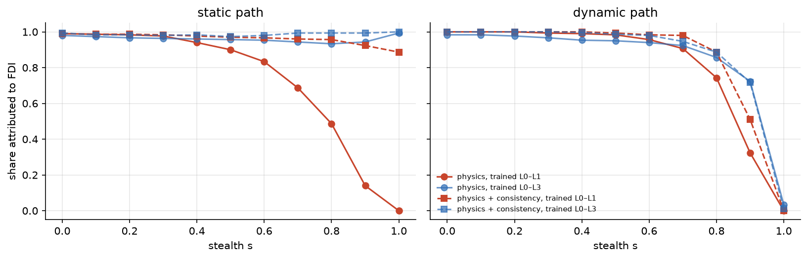

# Telling a broken sensor from a lying one

[](https://github.com/GMCavalheri/false-data-injection-detection-cps/actions/workflows/ci.yml)

A navigation sensor that reports the wrong altitude can be wrong in two ways. Its hardware may
have failed, and the right response is maintenance. Or the value may have been changed on its
way to the computer (**false data injection**, FDI), and the right response is incident
response. Fault-detection pipelines usually assume the first. This repository asks how well the
two can be told apart from the telemetry alone, and measures, honestly, where that stops working
as the attacker learns more physics.

The core is `fdicps`, a typed Python package (NumPy, SciPy, scikit-learn, PyTorch on CPU). It
comes with closed-form anchors for every detection rate that has one, a Kalman-filter
consistency model, a transfer test on a public industrial-control testbed, and a seven-lesson
course that derives every method from first principles.



## Headline results (synthetic system, stated assumptions)

The system is the generic navigation chain of
[CPS-02](https://github.com/GMCavalheri/cyber-physical-rbd-attack-trees) and
[CPS-01](https://github.com/GMCavalheri/cyber-attack-reliability-impact-modeling): two embedded
GNSS/INS units feeding a mission computer over a data bus, plus a dissimilar barometric altitude.
Physical faults and FDI at four levels (naive, plausible, statically consistent, dynamically
consistent) are injected with ground truth by construction. Every number is reproduced by
`validation/run_all.py`, and CI fails if one changes.

| question | answer | where |
|---|---|---|
| Can a standard anomaly detector say *why*? | No. It detects 75 % of faults and 35 % of attacks, and its score ranks faults above attacks (AUC 0.197 for "attack, not fault") | [Lesson 2](docs/lessons/02-the-detector-that-cannot-say-why.md) |
| Do physics residuals help? | Faults attributed 99 % correctly; naive to statically consistent attacks recognised 99–100 %; cause right for 99.9 % of flagged anomalies | [Lesson 3](docs/lessons/03-reading-physics-in-an-anomaly.md) |
| Where does attribution break? | At stealth $s$ = 0.8 (static) and 0.9 (dynamic) for a classifier trained on crude attacks; Kalman consistency features remove the static breakdown | [Lessons 4](docs/lessons/04-when-the-attacker-knows-the-physics.md), [5](docs/lessons/05-state-estimation-as-a-lie-detector.md) |
| What if the attacker copies a fault? | An exact copy is attributed to a fault every time, as Bayes' rule says any classifier must | [Lesson 4](docs/lessons/04-when-the-attacker-knows-the-physics.md) |
| How often is a spoof missed? (CPS-02 assumed 0.1) | 0.51 with a snapshot cross-check, 0.03 with an INS-aided filter; about 1 for a bus-level consistent injection | [Lessons 4, 5](docs/lessons/05-state-estimation-as-a-lie-detector.md) |
| What stops a fully consistent injection? | Only a sensor out of the attacker's reach, in the directions it observes: a protected baro exposes 100 % of vertical attacks and 1.3 % of along-track ones | [Lesson 5](docs/lessons/05-state-estimation-as-a-lie-detector.md) |
| Does the stealthy-attack theorem hold on a power grid? | Yes: IEEE 14-bus, residual change at rounding level (below 1e-12); noncentral detection law 0.461 closed form vs 0.463 Monte Carlo | [Lesson 5](docs/lessons/05-state-estimation-as-a-lie-detector.md) |
| Does detection transfer to a real ICS testbed? | Data-driven checks catch 5/5 and 15/20 attack events on HAI 21.03; the longest false alarm is an unseen operating point | [Lesson 6](docs/lessons/06-testing-on-someone-elses-plant.md) |

The full write-up, with limits, is [`docs/report.md`](docs/report.md). What is and is not new
is in [`docs/related-work.md`](docs/related-work.md): the theorems used are known; the
contribution is the evaluation along a stealth dial and its link to the reliability and
attack-tree models of the series.

## What is in it

| module | what it does |
|---|---|
| [`dual_anomaly_data_generation`](src/fdicps/dual_anomaly_data_generation/) | exact kinematics, 13-channel telemetry, physical faults, FDI levels L0–L3 and the stealth dial |
| [`baseline_anomaly_detection`](src/fdicps/baseline_anomaly_detection/) | rate and envelope checks, Isolation Forest on generic features |
| [`physical_vs_fdi_classification`](src/fdicps/physical_vs_fdi_classification/) | physics residuals, gradient boosting, a 1-D CNN |
| [`adversarial_robustness_analysis`](src/fdicps/adversarial_robustness_analysis/) | stealth sweeps, fault mimicry, spoofer reach, exact scenario monitors |
| [`cross_sensor_consistency_model`](src/fdicps/cross_sensor_consistency_model/) | WLS and the bad-data test, Kalman filter with NIS and CUSUM, IEEE 14-bus DC model |
| [`transfer`](src/fdicps/transfer/) | HAI loader (pinned and verified download), data-driven consistency checks |

## Quickstart

```bash
uv sync
uv run pytest --cov
uv run python validation/run_all.py
uv run python notebooks/build_notebooks.py
```

The HAI transfer needs the dataset (about 54 MB, never committed):

```bash
uv run python -m fdicps.transfer.fetch
uv run python validation/hai_transfer.py
```

A first look in code:

```python
from fdicps.dual_anomaly_data_generation.scenarios import make_scenario
from fdicps.dual_anomaly_data_generation.parameters import load_sensor_parameters
from fdicps.cross_sensor_consistency_model.detection import filter_axes, window_alarm

P = load_sensor_parameters()
for level in (1, 2, 3):
    s = make_scenario(7, "fdi", level=level)
    alarm = window_alarm(filter_axes(s.values[None], P), 0.01)[0]
    print(f"{s.subtype:14s} Kalman-filter alarm: {alarm}")
# L1 offset x    Kalman-filter alarm: True
# L2 offset x    Kalman-filter alarm: True
# L3 drag x      Kalman-filter alarm: False
```

## Documentation

* **Course:** [`docs/lessons/`](docs/lessons/README.md), seven lessons with derivations, worked
  examples and exercises with solutions, and one executed notebook per lesson in
  [`notebooks/`](notebooks/).
* **Theory notes:** one per module in [`docs/`](docs/).
* **Report:** [`docs/report.md`](docs/report.md). **Related work:** [`docs/related-work.md`](docs/related-work.md).
  **Scope:** [`docs/scope.md`](docs/scope.md).
* **Results:** [`validation/results/`](validation/results/), regenerated by the scripts in
  [`validation/`](validation/).

## Engineering

* 139 tests (pytest + Hypothesis), 99 % coverage with a 90 % gate. Every test asserts against a
  closed form (zero-order-hold kinematics, noise variances, chi-square and noncentral chi-square
  laws, the DARE solution, the stealthy-attack theorem), an independent oracle (CPS-02's `cpsrbd`
  for the shared system, MATPOWER's `case14` data) or Monte Carlo inside its own confidence interval.
  Property tests check that detectability never rises with stealth.
* `ruff`, strict `mypy`, CI on Python 3.11–3.13, gitleaks and pip-audit, Dependabot.
* A `reproduce` CI job reruns every validation script and fails if any committed table changes
  (the CNN's within a stated tolerance), then executes every notebook.
* Determinism: every random draw comes from a seeded generator; the CNN is seeded, single-threaded
  and uses deterministic algorithms.
* **Not included, on purpose:** this is a library and a course, not a deployed service, so there is
  no staging environment, observability stack or feature-flag service.

## Deviations from the plan

* The plan proposed reusing physics-based generators from two earlier fault-detection projects
  (engine parts, structural health monitoring). Neither was built, so the kinematic GNSS/INS
  generator is written here and the planned `external/` folder is dropped.
* The navigation chain gains a dissimilar barometric altitude source, labelled an addition to the
  CPS-02 architecture; it is what makes the value of a protected sensor measurable.
* The plan's extension to the avionics data bus is folded in: the injection point is the CPS-02
  data bus. The extension using attack-tree outputs as a classifier prior is left as future work.
* Public testbed data: HAI is used (public, CC BY-SA 4.0 per its README); SWaT, distributed on
  request, is not.

## Data credits

HAI: H.-K. Shin, W. Lee, J.-H. Yun and H. Kim, "HAI 1.0: HIL-based augmented ICS security dataset,"
USENIX CSET 2020, <https://github.com/icsdataset/hai> (version 21.03). IEEE 14-bus branch data:
MATPOWER `case14` (R. D. Zimmerman *et al.*, IEEE Transactions on Power Systems, 2011).

## Licence

MIT. See [LICENSE](LICENSE).
