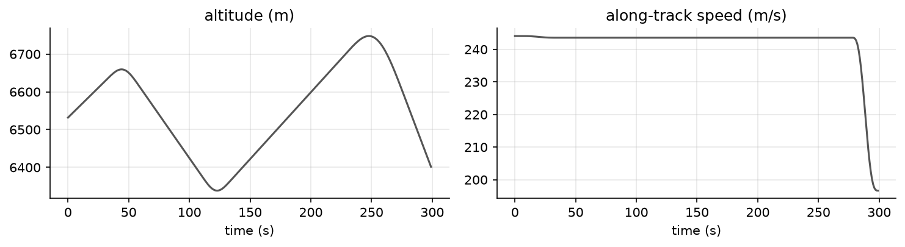
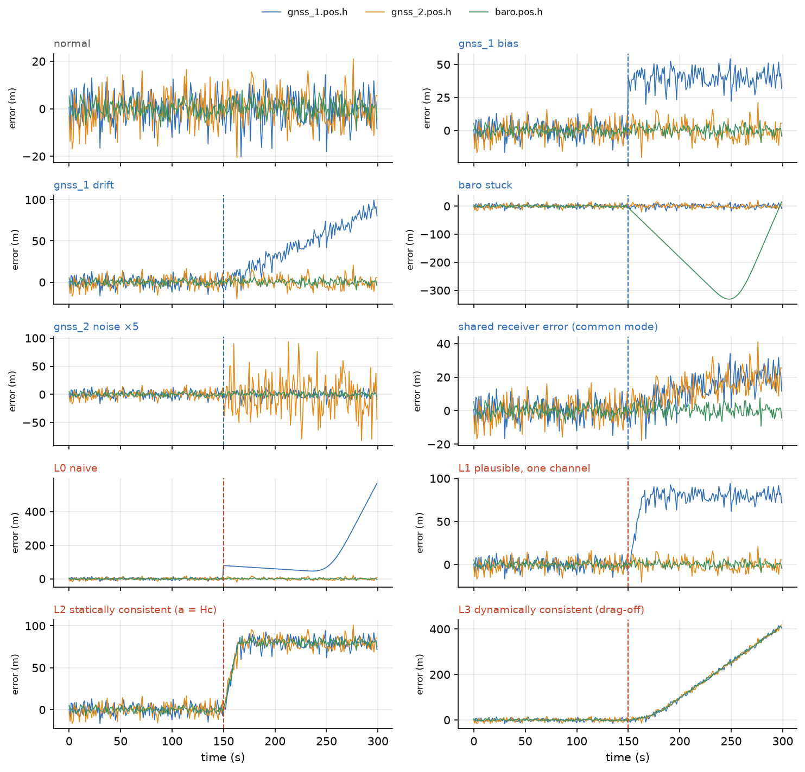

# Lesson 1 · Two kinds of wrong: a broken sensor and a lying one

> A navigation sensor that reports the wrong altitude can be wrong in two ways. Its hardware
> may have failed, and then the right response is a maintenance action. Or the value may have
> been changed on its way to the computer, and then the right response is a security
> incident. A detector that only says "anomaly" leaves the most important question open.
> This lesson builds the data set on which the rest of the course asks it: a simulated
> navigation chain whose telemetry carries both kinds of wrong, with the answer known.

**Code:** [`src/fdicps/dual_anomaly_data_generation/`](../../src/fdicps/dual_anomaly_data_generation/) ·
**Data:** [`sensor_parameters.csv`](../../src/fdicps/data/sensor_parameters.csv),
[`anomaly_parameters.csv`](../../src/fdicps/data/anomaly_parameters.csv) ·
**Tests:** [`tests/test_generation.py`](../../tests/test_generation.py) ·
**Results:** [`validation/results/generation.md`](../../validation/results/generation.md) ·
**Scope:** [`docs/scope.md`](../scope.md) ·
**Next:** [Lesson 2](02-the-detector-that-cannot-say-why.md)

## Learning objectives

By the end of this lesson you should be able to:

1. Explain why "physical fault or false data?" matters operationally, and why a plain anomaly
   detector cannot answer it.
2. Derive the exact discrete kinematic model of an aircraft axis under a zero-order-hold
   acceleration, and use it to generate a trajectory.
3. Size a white-noise standard deviation from a published 95 % accuracy figure.
4. Write down the four physical fault types and the shared receiver error as changes to the
   telemetry, and say what each one looks like.
5. Construct false data injections of increasing sophistication, and prove that the
   statically consistent one, a = Hc, leaves every least-squares residual unchanged.

---

## 1. Why the distinction matters

Every fault-detection project quietly assumes that anomalous data reflect a real physical
problem. In an adversarial setting the assumption fails. False data injection (FDI) means
values that reach a consumer, here the mission computer, differ from what the sensors
measured. The research literature on power-grid state estimation showed in 2009 that such
values can be *crafted* to pass the standard consistency check of the estimator (Liu, Ning
and Reiter); the same algebra applies to any system that fuses redundant sensors, including
a navigation system.

The two kinds of wrong call for different responses:

| | physical fault | false data injection |
|---|---|---|
| cause | hardware degrades or fails | values changed between sensor and consumer |
| shape | whatever the failure physics produces | whatever the adversary chooses |
| intent | none | to move the system's estimate of its own state |
| response | maintenance: isolate and replace the unit | security: incident response, isolate the data path |

The adversary's freedom of shape is the whole difficulty. A failing receiver does not try to
look healthy; an attacker does. The project measures how far physics-based features carry
a detector before that freedom wins.

## 2. The navigation chain

The system is the synthetic navigation chain of CPS-02 and CPS-01. Two embedded GNSS/INS units
(`egi_1`, `egi_2`) deliver, on each axis, a GNSS position, a GNSS velocity and an inertial
acceleration. This project adds a dissimilar source, a barometric altitude from an air-data
unit (`air_data`), labelled an addition to the CPS-02 architecture. The mission computer
receives 13 channels at 1 Hz, on two axes: along-track (`x`) and vertical (`h`).



### Exact kinematics

On one axis the state is position and velocity, driven by an acceleration $a$ that is held
constant over each sample interval of length $\Delta t$ (zero-order hold). Integrating twice
over one interval gives, with no approximation,

```math
\begin{bmatrix} p_{k+1} \\ v_{k+1} \end{bmatrix}
= \underbrace{\begin{bmatrix} 1 & \Delta t \\ 0 & 1 \end{bmatrix}}_{F}
\begin{bmatrix} p_{k} \\ v_{k} \end{bmatrix}
+ \underbrace{\begin{bmatrix} \Delta t^{2}/2 \\ \Delta t \end{bmatrix}}_{G} a_{k}.
```

This is the discretised kinematic model of the tracking literature (Bar-Shalom, Li and
Kirubarajan, 2001). It matters that it is exact. The truth generator, the attacker's
dynamically consistent injection and the Kalman filter of Lesson 5 all use the same $F$ and
$G$, so when the course says an attack is "consistent with the physics", the statement holds
to rounding error, not to the accuracy of a discretisation.

The flight segment is 300 s long. On each axis the velocity moves to up to three new targets
through raised-cosine acceleration pulses, normalised so that each pulse integrates to
exactly the velocity change it is meant to produce.

### Sizing the noise

Each channel carries independent white Gaussian noise. The GNSS position noise is sized from
the public GPS SPS Performance Standard (5th edition, 2020), whose global-average accuracy is
of the order of 8 m horizontally and 13 m vertically at 95 %. For one Gaussian axis, 95 % of
the mass lies within $1.96\sigma$, so the vertical noise is

```math
\sigma_{h} = \frac{13}{1.96} \approx 6.6\ \text{m}.
```

A horizontal error is two-dimensional. If both components have standard deviation $\sigma$,
the radius $R$ follows a Rayleigh law with $P(R \le r) = 1 - e^{-r^{2}/2\sigma^{2}}$, and
setting this to 0.95 gives $r = \sigma\sqrt{-2\ln 0.05} = 2.45\sigma$. Hence

```math
\sigma_{x} = \frac{8}{2.45} \approx 3.3\ \text{m}.
```

The other values (velocity 0.1 m/s, accelerometer noise 0.02 m/s² and bias about 1 mg,
barometric altitude 3 m) are labelled assumptions. Real GNSS errors are correlated in time;
white noise is a deliberate simplification that keeps every consistency test of the course
exact (Lesson 5).

## 3. Physical faults

A physical fault lives in one piece of hardware, so it changes the outputs of **one unit**,
and only in ways hardware fails. With onset $k_0$ and elapsed time $\tau = (k - k_0)\Delta t$:

| fault | change to the unit's outputs |
|---|---|
| bias | $z \to z + b$ for $k \ge k_0$ (GNSS position, INS acceleration or baro altitude) |
| drift | $z \to z + r\tau$ |
| stuck | $z_k \to z_{k_0 - 1}$: every output frozen, no noise |
| noise | extra noise of standard deviation $\sigma\sqrt{m^{2}-1}$, so the total is $m\sigma$ |

The noise row uses the fact that independent Gaussian variances add: $\sigma^{2} + \sigma^{2}(m^{2}-1) = m^{2}\sigma^{2}$.

There is one more physical event, included on purpose: a **shared receiver error**. Both
receivers on one aircraft see the same satellites through the same atmosphere, so an
ionospheric-like error moves both GNSS positions *together*, slowly and up to a cap,

```math
e(\tau) = \min(r\tau,\ e_{\max}).
```

Without it, a classifier could learn the shortcut "both receivers moved together, so it is an
attack". Nature can do that too, and the data set says so.

## 4. False data injection, four levels

The attack is a vector $a_k$ added to the 13 measured values. What changes from level to level
is how much physics $a_k$ respects:

| level | pattern | what it respects | what still betrays it |
|---|---|---|---|
| **L0** naive | one channel replaced by a noise-free straight line plus a jump | nothing | no noise; the line ignores manoeuvres |
| **L1** plausible | an offset ramped into one real measurement | range, rate, noise | the peers disagree |
| **L2** statically consistent | the same offset on every position channel of the axis | every snapshot check | position moves while velocity does not |
| **L3** dynamically consistent | a drag-off integrated with $F$ and $G$, INS included | all modelled physics | only a source outside the attacker's reach |

### Why L2 passes every snapshot check

At one instant the position and velocity channels of an axis obey $z = Hx + e$, with one row of
$H$ per channel: $[1, 0]$ for a position and $[0, 1]$ for a velocity. Weighted least squares,
with $W$ the inverse noise covariance, estimates

```math
\hat{x} = (H^{\top} W H)^{-1} H^{\top} W z, \qquad
r = z - H\hat{x} = (I - K)z, \qquad K = H (H^{\top} W H)^{-1} H^{\top} W.
```

Every consistency check on a snapshot is a function of the residual $r$. Now $KH = H$, so
$(I - K)H = 0$. An attack of the form $a = Hc$ therefore gives

```math
r_{a} = (I - K)(z + Hc) = (I - K)z = r.
```

The residual does not change at all, however large $c$ is. This is the central result of Liu,
Ning and Reiter (2009). L2 uses $c = [\Delta p, 0]$: the same position offset on both receivers
(and on the baro, vertically), and no change to the velocities.

### Why L3 passes the dynamics too

L2 is static. Over time, position moves while velocity does not, which contradicts
$p_{k+1} = p_k + v_k\Delta t + \dots$. A drag-off fixes that. The attacker chooses a small
acceleration $\delta a$ for a duration $D$, and integrates it with the aircraft's own $F$ and $G$
into a velocity offset and a position offset, adding $\delta a$ to the inertial channels too. The
injected trajectory is then a trajectory the aircraft could have flown. Nothing in the
modelled physics can see it. The only witness left is a sensor the attacker does not reach.

### The consistency knob

For the robustness analysis of Lesson 4, an attack is blended between its single-channel and
its fully consistent version:

```math
a(s) = s\,A + (1 - s)\,A_{\text{target}}, \qquad s \in [0, 1].
```

Here $A_{\text{target}}$ is $A$ with every column but the target channel set to zero. The target
channel's injection is the same for every $s$, so the attacker's intended effect is fixed and
only the stealth changes. Because $(I - K)A = 0$, the residual of $a(s)$ is $(1 - s)$ times that
of the single-channel attack: exactly linear in $s$. A Hypothesis test checks this for random
attacks.

### Mapping to CPS-02

CPS-02's attack tree has two leaves whose *effects* these injections are:
`inject_false_nav_messages` (values changed on the data bus, every level here) and
`gnss_spoof` (both receivers walked off together, which is an L3 drag-off with the INS and
the baro untouched). CPS-02 assumed that the navigation integrity cross-check misses a
spoofed solution with probability 0.1 (`integrity_monitor_miss`). This project measures that
number as a function of sophistication. A test checks that these names exist in `cpsrbd`
v1.0.0.

## 5. Ground truth by construction

Each scenario is one 300 s segment with at most one anomaly, starting between 100 s and 200 s.
Its seed is split into three independent random streams with `SeedSequence.spawn`: trajectory,
sensor noise, anomaly. The same seed therefore gives the same clean telemetry *whatever* anomaly
is injected, so any comparison between anomaly types is paired and exact.

The training set uses seeds 0 to 2999 and the test set seeds 1 000 000 to 1 001 499. Each is one
third normal, one third physical fault, one third FDI cycling through L0 to L3. No scenario
appears on both sides, a rule every later phase keeps.



Read the figure row by row. A receiver bias is a step in one channel; a drift is a ramp; a
stuck baro is a frozen value while the aircraft keeps climbing; extra noise widens one trace.
The shared receiver error moves both receivers, but not the baro. L1 looks like a bias with a
ramp-in. L2 moves all three altitude sources together, so no snapshot comparison can see it.
L3 bends all three along a parabola and then a straight line, just as a real climb would.

### Plan deviations

The project plan proposed reusing physics-based generators from two earlier projects. Neither
was built, so the kinematic generator is written here and the planned `external/` folder is
dropped. The baro source is the one architectural addition, labelled as such.

## 6. Worked example

An L3 drag-off on the vertical axis starts at $k_0 = 150$ s with $\delta a = 0.08$ m/s² for
$D = 40$ s. Under zero-order hold the velocity offset after $n$ samples is $n \delta a \Delta t$ and the
position offset is

```math
\Delta p_{n} = \sum_{j=0}^{n-1}\left(j\,\delta a\,\Delta t^{2} + \tfrac{1}{2}\delta a\,\Delta t^{2}\right) = \tfrac{1}{2}\,\delta a\,n^{2}\Delta t^{2}.
```

At the end of the drag, $n = 40$: $\Delta v = 3.2$ m/s and $\Delta p = 0.5 \times 0.08 \times 1600 = 64$ m. The
velocity offset then stays at 3.2 m/s, so at $t = 299$ s, 109 s later,
$\Delta p = 64 + 3.2 \times 109 = 412.8$ m. The code agrees, and the WLS residual does not move:

```python
import numpy as np

from fdicps.dual_anomaly_data_generation.fdi import FalseDataInjection, injection
from fdicps.dual_anomaly_data_generation.parameters import load_sensor_parameters
from fdicps.dual_anomaly_data_generation.sensors import (
    CHANNEL_NAMES,
    measurement_model,
    nominal_sigma,
)

P = load_sensor_parameters()
drag = FalseDataInjection(
    level=3, pattern="drag", axis=1, onset=150, magnitude=0.08, ramp=40.0, target=6
)
a = injection(drag, P, P.n_steps)
for name in ("gnss_1.pos.h", "gnss_1.vel.h", "ins_1.acc.h"):
    j = CHANNEL_NAMES.index(name)
    print(f"{name:13s} at t=190: {a[190, j]:7.2f}   at t=299: {a[299, j]:7.2f}")
# gnss_1.pos.h  at t=190:   64.00   at t=299:  412.80
# gnss_1.vel.h  at t=190:    3.20   at t=299:    3.20
# ins_1.acc.h   at t=190:    0.00   at t=299:    0.00

idx, H = measurement_model(1)
W = np.diag(1 / nominal_sigma(P)[idx] ** 2)
S = np.eye(len(idx)) - H @ np.linalg.solve(H.T @ W @ H, H.T @ W)
print("largest WLS residual change:", np.abs(a[:, idx] @ S.T).max())
# largest WLS residual change: 5.6170273111140464e-14
```

A 413 m altitude error, invisible to the snapshot check. The inertial acceleration offset is
zero at both printed times because the drag phase is over by then; during it, the INS channels
carried the extra 0.08 m/s² that keeps the story consistent.

## 7. Code walkthrough

* [`mission.py`](../../src/fdicps/dual_anomaly_data_generation/mission.py): `transition()`
  returns $F$ and $G$; `integrate()` is the vectorised recursion; `mission_profile()` draws a
  segment.
* [`sensors.py`](../../src/fdicps/dual_anomaly_data_generation/sensors.py): the 13 `CHANNELS`,
  `nominal_sigma()`, `measurement_model(axis)` (the $H$ above) and `measure()`.
* [`faults.py`](../../src/fdicps/dual_anomaly_data_generation/faults.py): `PhysicalFault` and
  `apply_fault()`.
* [`fdi.py`](../../src/fdicps/dual_anomaly_data_generation/fdi.py): `FalseDataInjection`,
  `consistent_injection()` (the matrix $A$), `injection()` (the blend) and `cps02_leaf()`.
* [`scenarios.py`](../../src/fdicps/dual_anomaly_data_generation/scenarios.py): sampling,
  `make_scenario()` with the three seed streams, and `generate_dataset()`.

The tests in [`tests/test_generation.py`](../../tests/test_generation.py) check each claim of
this lesson: the recursion to 1e-12, the noise variances against a chi-square interval, every
fault signature, $(I - K)a = 0$ for L2 and the exact kinematics of L3.

## Exercises

1. A receiver's vertical accuracy is specified as 20 m at 95 %. What white-noise $\sigma$ does
   that imply? And a horizontal accuracy of 20 m at 95 %?
2. Show that $KH = H$ for $K = H(H^{\top}WH)^{-1}H^{\top}W$, and that $K$ is a projection ($K^{2} = K$).
3. On the along-track axis there is no baro. Write $H$ for that axis. How many independent
   residual directions are there, and how many on the vertical axis?
4. An L2 attack shifts both receivers' positions by 100 m but not the baro. Is it still
   invisible to the vertical snapshot check? Why does this matter for where the baro's data
   travel?
5. A drag-off with $\delta a = 0.05$ m/s² lasts 60 s. What are the velocity and position offsets
   at the end of the drag, and 100 s after it?
6. Why would a classifier trained without the shared receiver error be likely to overstate
   its ability to recognise attacks?

### Solutions

1. Vertical: $\sigma = 20/1.96 = 10.2$ m. Horizontal: $\sigma = 20/2.45 = 8.2$ m per axis.
2. $KH = H(H^{\top}WH)^{-1}(H^{\top}WH) = H$. Then $K^{2} = H(H^{\top}WH)^{-1}H^{\top}W K$, and
   $H^{\top}WK = H^{\top}WH(H^{\top}WH)^{-1}H^{\top}W = H^{\top}W$, so $K^{2} = K$.
3. Rows $[1,0], [0,1], [1,0], [0,1]$: four measurements, two states, so $4 - 2 = 2$ residual
   directions. Vertically, five measurements give $5 - 2 = 3$.
4. No. The vector is no longer in the range of $H$, because the baro row would need the same
   100 m, so the residual changes. A dissimilar source helps only if the attacker cannot reach
   it, which is why it matters whether the baro shares the data path; Lesson 5 measures this.
5. At the end, $\Delta v = 0.05 \times 60 = 3$ m/s and $\Delta p = 0.5 \times 0.05 \times 3600 = 90$ m.
   After 100 s more, $\Delta p = 90 + 300 = 390$ m.
6. Without it, every physical fault touches one unit, so "two units moved together" would
   separate faults from L2 and L3 attacks perfectly in training. The shortcut fails the first
   time the atmosphere moves both receivers, and the measured accuracy would not survive it.

## References

* Y. Liu, P. Ning and M. K. Reiter, "False data injection attacks against state estimation in
  electric power grids," *Proc. 16th ACM Conference on Computer and Communications Security
  (CCS)*, 2009 (the a = Hc construction).
* Y. Bar-Shalom, X. R. Li and T. Kirubarajan, *Estimation with Applications to Tracking and
  Navigation*, Wiley, 2001 (discretised kinematic models, weighted least squares).
* P. D. Groves, *Principles of GNSS, Inertial, and Multisensor Integrated Navigation Systems*,
  2nd ed., Artech House, 2013 (sensor error models).
* U.S. Department of Defense, *Global Positioning System Standard Positioning Service
  Performance Standard*, 5th ed., April 2020 (position accuracy standards).
