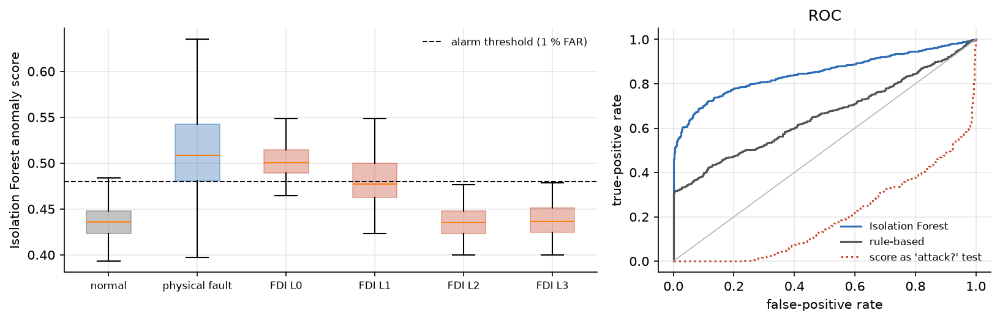

# Lesson 2 · The detector that can't say why

> The standard toolkit of fault detection is good at one question: *is this data unusual?*
> This lesson builds that toolkit for the navigation chain, a rule-based rate check and an
> Isolation Forest trained on normal flight, and measures it honestly. It catches most loud
> problems. But it returns one number, and that number answers a different question from the
> one the operator needs answered. Worse, it ranks faults above attacks, because a careful
> attacker is, by design, quiet.

**Code:** [`src/fdicps/baseline_anomaly_detection/`](../../src/fdicps/baseline_anomaly_detection/) ·
**Tests:** [`tests/test_baseline.py`](../../tests/test_baseline.py) ·
**Results:** [`validation/results/baseline.md`](../../validation/results/baseline.md) ·
**Previous:** [Lesson 1](01-two-kinds-of-wrong.md) ·
**Next:** [Lesson 3](03-reading-physics-in-an-anomaly.md)

## Learning objectives

By the end of this lesson you should be able to:

1. Derive the noise variance of a second difference and the false-alarm probability of a
   rate check, for one test and for a whole scenario.
2. Explain how an Isolation Forest scores a point, and how a novelty detector's threshold is
   set from normal data.
3. Read a detection table by anomaly family, and explain why some physical faults are hard
   to see even for a good detector.
4. Explain why an anomaly score cannot attribute cause, and why its ranking can even point the
   wrong way.

---

## 1. What a competent baseline looks like

A fault-detection engineer with no model of an adversary would build two things:

* **Rule-based checks**, the monitors every data consumer in an avionics system already has:
  is the value inside the physical envelope, and is it changing at a physically possible
  rate?
* **A data-driven detector**, trained on normal operation only (novelty detection), over
  features that summarise each channel's noise and compare redundant sensors that measure
  the same quantity.

Both say *that* something is unusual. Neither encodes a hypothesis about *why*. That is the
point of the baseline: it is the best you can do while assuming every anomaly is a fault.

## 2. The rate check and its false-alarm rate

A rate check must ignore the aircraft's own motion. The second difference does that for any
signal that is locally a straight line:

```math
d_{k} = z_{k} - 2z_{k-1} + z_{k-2}.
```

If $z_{k} = \alpha + \beta k + e_{k}$, the $\alpha$ and $\beta$ terms cancel exactly and only the noise is
left. With independent noise of variance $\sigma^{2}$, the coefficients $1, -2, 1$ give

```math
\operatorname{Var}(d_{k}) = (1^{2} + 2^{2} + 1^{2})\,\sigma^{2} = 6\sigma^{2}.
```

The check flags a sample when $|d_{k}| > \kappa\sigma\sqrt{6}$. For one test on straight-and-level
flight the false-alarm probability is exactly

```math
p_{1} = P(|Z| > \kappa) = 2\left(1 - \Phi(\kappa)\right), \qquad Z \sim N(0,1).
```

A scenario runs $n = 13 \times 298 = 3874$ such tests. By the union bound the scenario false-alarm
probability is at most $n p_{1}$. Neighbouring second differences share samples, so the tests are
not independent; but for small $p_{1}$ the bound and the independent-tests formula $1 - (1-p_{1})^{n}$
agree to the digits shown (Section 6). The test suite checks $p_{1}$ itself by Monte Carlo, using
every third second difference, which share no samples and are therefore independent.

Manoeuvres add a small true part to $d_{k}$, at most $a_{\max}\Delta t^{2} = 1$ m on a position channel,
against $\sigma\sqrt{6} \approx 8$ to 16 m of noise. The results confirm the effect is negligible:

| quantity | value |
|---|---|
| one rate test, closed form, $\kappa = 5$ | 5.733e-07 |
| one rate test, measured on the 500 test normals | 5.163e-07 |
| rule-based false-alarm rate per scenario | 0.002 |

The envelope check adds limits that no aircraft of this kind can exceed (vertical speed of
30 m/s, accelerations of 3 m/s², altitude below zero or above 15 km).

## 3. Features and the Isolation Forest

### Generic features

Each scenario becomes 47 numbers, each normalised by its healthy noise level so that "1" means
"as expected":

* for each of the 13 channels, the standard deviation and the largest magnitude of the
  normalised second difference;
* for each of 7 redundant comparisons (receiver 1 against receiver 2 for each GNSS quantity,
  INS 1 against INS 2 for each axis, the baro against the mean of the two receivers), the
  mean, the standard deviation and the largest deviation from the mean of the normalised
  difference.

A test checks the normalisation: on healthy straight-and-level flight the averages come out at
1 within 0.03.

### How an Isolation Forest scores a point

An isolation tree splits the data at random: a random feature, then a random threshold between
that feature's minimum and maximum, recursively, until each point is alone. Unusual points are
easier to isolate, so they end up closer to the root. With $h(x)$ the path length of $x$ in one
tree and $E[h(x)]$ its average over the forest, the anomaly score is (Liu, Ting and Zhou, 2008)

```math
s(x, n) = 2^{-E[h(x)]/c(n)}, \qquad c(n) = 2H(n-1) - \frac{2(n-1)}{n},
```

where $c(n)$ is the average path length of an unsuccessful search in a binary search tree of $n$
points and $H(i) \approx \ln i + 0.5772$ is the harmonic number. Scores near 1 are anomalies;
around 0.5 or below, normal. scikit-learn's `score_samples` returns $-s$; the code flips the
sign so that larger means more anomalous.

The forest is trained on the 1000 normal training scenarios. The alarm threshold is the 99th
percentile of their own scores, a 1 % target false-alarm rate. On the 500 test normals the
realised rate is 1.4 %, within the sampling error of a percentile estimated from 1000 points.

## 4. What it detects



Overall, on the 1500 test scenarios:

| detector | ROC AUC normal vs anomalous | detection rate, faults | detection rate, FDI |
|---|---|---|---|
| Isolation Forest | 0.85 | 0.754 | 0.348 |
| rule-based | 0.658 | 0.41 | 0.22 |

By family, a few rows explain most of the picture:

| family | Isolation Forest | rule-based |
|---|---|---|
| gnss bias, drift, noise, stuck | 1 | 0 to 1 |
| ins bias | 0.4 | 0 |
| gnss common_mode | 0.107 | 0 |
| L0 replace | 0.912 | 0.856 |
| L1 offset | 0.456 | 0.008 |
| L2 offset | 0.024 | 0.016 |
| L3 drag | 0 | 0 |

Three observations:

* **Loud faults are easy.** A receiver that drifts, freezes or gets noisy disagrees with its twin,
  and the pair features see it.
* **Some faults are quiet.** An accelerometer bias shift of 0.02 to 0.1 m/s² hides inside the
  normal spread of the two units' constant bias difference (each unit's bias has a standard
  deviation of 0.01 m/s²). The shared receiver error moves both receivers together, so the
  receiver pair sees nothing and only the baro comparison is left. These are physical faults
  that look like the sophisticated attacks: a fact Lesson 3 will meet again.
* **Detection falls with sophistication.** L0 has no noise and ignores manoeuvres, so it is
  found. L1 has normal noise but one channel disagrees with its peers: found about half the
  time. L2 and L3 leave every redundant comparison intact, so the detector sees normal flight.

## 5. Why it cannot say why

The detector outputs one number per scenario. The operator needs a decision with two
different responses: maintenance or incident response. One number can only be thresholded,
so the best this detector could ever do is to route by score, "high score: call security".

Look at who actually raises the alarms:

| true cause of an Isolation Forest alarm | share of alarms |
|---|---|
| physical fault | 0.684 |
| FDI L0 | 0.207 |
| FDI L1 | 0.103 |
| FDI L2 | 0.005 |
| FDI L3 | 0 |

And use the score itself as a test for "attack, not fault":

| question | value |
|---|---|
| ROC AUC of the anomaly score for 'attack, not fault', all anomalies | 0.197 |
| the same, among alarms only | 0.296 |
| share of FDI scenarios that raise no alarm at all | 0.652 |

An AUC of 0.5 would mean the score carries no information about cause. 0.197 is *worse*: a
higher score makes "fault" more likely. The reason is structural, not a defect of the forest.
An anomaly score measures distance from normal. Physical faults are not trying to look normal,
so they are far away. Attacks that matter most are built to look normal, so they are close.
The more sophisticated the attack, the lower its score. Routing high scores to security would
send it mostly faults, and the attacks it should catch would not have raised an alarm at all.

This is the gap the rest of the course works on. Lesson 3 asks the question directly, with
features that encode *how* each kind of wrong behaves physically.

## 6. Worked example

The rate check's false-alarm budget, from the closed form:

```python
from fdicps.baseline_anomaly_detection.rate_check import single_test_false_alarm

p = single_test_false_alarm(5.0)
n_tests = 13 * 298  # channels x second differences per 300-sample scenario
print(f"one test: {p:.3e}")
print(f"union bound per scenario: {n_tests * p:.4f}")
print(f"if independent: {1 - (1 - p) ** n_tests:.4f}")
# one test: 5.733e-07
# union bound per scenario: 0.0022
# if independent: 0.0022
```

The measured per-scenario rate on the test normals is 0.002: one false alarm in 500.

And the routing arithmetic. Suppose every Isolation Forest alarm on the test set is sent to the
security team. There are 551 alarms on anomalous scenarios plus 7 on normal ones. Of the 551,
377 are physical faults, so 68 % of the security team's work would be maintenance problems.
Of the 500 FDI scenarios, 174 reach them (114 + 57 + 3), and all 125 L3 attacks never do.

## 7. Code walkthrough

* [`rate_check.py`](../../src/fdicps/baseline_anomaly_detection/rate_check.py):
  `rate_scores()` (normalised $|d_{k}|$), `single_test_false_alarm()`, `envelope_violations()` and
  `rule_score()`, the scenario score (the largest rate score, or infinity outside the
  envelope).
* [`features.py`](../../src/fdicps/baseline_anomaly_detection/features.py): `generic_features()`
  and the `PAIRS` of redundant comparisons.
* [`detector.py`](../../src/fdicps/baseline_anomaly_detection/detector.py): `BaselineDetector`,
  a thin wrapper that trains the forest on normal scenarios and sets the threshold.
* [`validation/baseline.py`](../../validation/baseline.py) produces every number in this lesson.

## Exercises

1. A channel's noise is not white but a random walk, $e_{k} = e_{k-1} + w_{k}$ with
   $\operatorname{Var}(w_{k}) = q$. What is the variance of the second difference?
2. Set $\kappa$ so that the union bound on the per-scenario false-alarm rate is 1 %.
3. The training normals give a threshold at their 99th percentile. If the scores of normal
   scenarios were exchangeable with the training ones, what would the expected test false-alarm
   rate be, and roughly what is its standard error for 500 test normals?
4. The forest detects 40 % of INS bias faults. Using only the parameter table, explain why a
   bias shift of 0.02 m/s² is hard to see in the INS pair difference, while a shift of 0.1 m/s²
   is not.
5. An analyst proposes to route alarms with score above 0.55 to security. Using the figure,
   which group would that mostly send them, and why?
6. Why would *adding more redundant sensors of the same kind* not help this detector against L2?

### Solutions

1. $d_{k} = e_{k} - 2e_{k-1} + e_{k-2} = w_{k} - w_{k-1}$, so the variance is $2q$. The check would need
   its own noise model; white-noise thresholds would be wrong.
2. $3874 \cdot 2(1 - \Phi(\kappa)) = 0.01$ gives $1 - \Phi(\kappa) = 1.29 \times 10^{-6}$, so
   $\kappa \approx 4.70$.
3. 1 %. The number of false alarms is roughly binomial with $n = 500$, $p = 0.01$, so the standard
   error of the rate is $\sqrt{0.01 \times 0.99/500} \approx 0.0045$. The realised 1.4 % is within one
   standard error; and the threshold itself is uncertain because it comes from 1000 points.
4. The two units' constant biases each have a standard deviation of 0.01 m/s², so their
   difference varies from flight to flight with a standard deviation of about 0.014 m/s². A
   0.02 m/s² shift, present for only part of the segment, sits inside that spread; 0.1 m/s² is
   about seven of those standard deviations.
5. Almost only physical faults: only faults reach that high, because they are the loudest
   anomalies. The attacks the rule should catch score below the alarm threshold altogether.
6. L2 applies the same offset to every channel measuring that position. More channels of the
   same kind only mean more rows of $H$ with the same structure; the injection is still in the
   range of $H$, and every redundant comparison still sees zero difference. Only a sensor the
   attacker cannot reach breaks it.

## References

* F. T. Liu, K. M. Ting and Z.-H. Zhou, "Isolation forest," *Proc. 8th IEEE International
  Conference on Data Mining (ICDM)*, 2008.
* V. Chandola, A. Banerjee and V. Kumar, "Anomaly detection: a survey," *ACM Computing Surveys*
  41(3), 2009.
* T. Fawcett, "An introduction to ROC analysis," *Pattern Recognition Letters* 27(8), 2006.
* Y. Liu, P. Ning and M. K. Reiter, "False data injection attacks against state estimation in
  electric power grids," *Proc. ACM CCS*, 2009.
