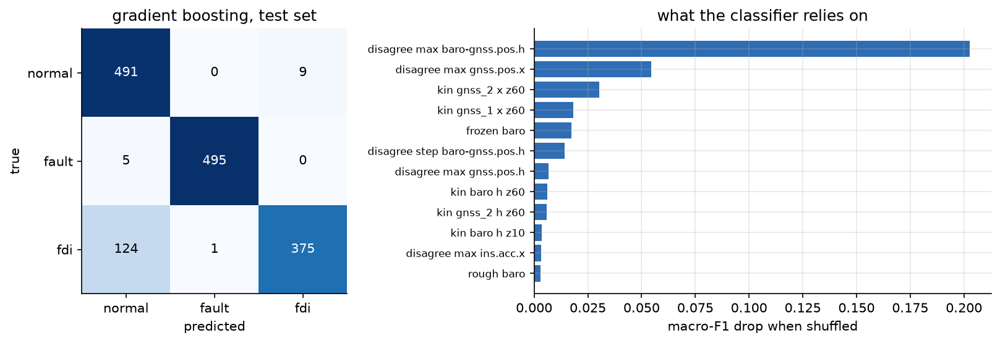

# Lesson 3 · Reading physics in an anomaly

> Lesson 2's detector asked "is this unusual?" and could not say why. This lesson asks a
> sharper question: *which physical relation broke, on which unit, and how?* A receiver whose
> position no longer follows its own velocity, two receivers that went wrong together, an
> output with no noise at all: each is a clue about the cause. Built into features, these
> clues let a classifier tell faults from false data almost perfectly, up to exactly the
> point where the attacker starts respecting the physics.

**Code:** [`src/fdicps/physical_vs_fdi_classification/`](../../src/fdicps/physical_vs_fdi_classification/) ·
**Tests:** [`tests/test_classification.py`](../../tests/test_classification.py) ·
**Results:** [`validation/results/classification.md`](../../validation/results/classification.md),
[`sequence_model.md`](../../validation/results/sequence_model.md) ·
**Previous:** [Lesson 2](02-the-detector-that-cannot-say-why.md) ·
**Next:** [Lesson 4](04-when-the-attacker-knows-the-physics.md)

## Learning objectives

By the end of this lesson you should be able to:

1. Turn a physical relation between sensors into a residual that is standard normal while the
   chain is healthy, including the exact variance of a window sum.
2. List the signatures that separate physical faults from FDI in this chain, and say which
   physical relation each one tests.
3. Train and read a gradient-boosting classifier, its confusion matrix and its permutation
   importances, and know what permutation importance can hide.
4. Compare a hand-featured model with a sequence model fairly, and say what the comparison
   does and does not show.
5. Say which parts of the classifier's success come from physics and which from assumptions
   about the attacker.

---

## 1. From "unusual" to "which relation broke"

The telemetry obeys relations that hold whatever the aircraft does:

* a receiver's position changes by its velocity times $\Delta t$, plus the acceleration term
  (Lesson 1's exact zero-order-hold relation);
* the receivers' velocity changes by the inertial acceleration times $\Delta t$;
* the baro altitude changes by the vertical velocity times $\Delta t$;
* redundant sensors of the same quantity agree;
* every output carries its sensor's noise, no more and no less.

A physical fault breaks the relations of **one unit**, in a way hardware fails. The attacks of
Lesson 1 break progressively fewer of them. So the useful question is not "how far from
normal?" but "which relation, where, and how?".

## 2. Residuals that are standard normal

### The kinematic residual of a receiver

With $\bar a_{k}$ the mean of the two INS accelerations,

```math
r_{k} = p_{k+1} - p_{k} - v_{k}\Delta t - \tfrac{1}{2}\bar a_{k}\Delta t^{2}.
```

On noise-free telemetry this is exactly zero (a test checks it to $10^{-6}$). With noise, a single
$r_{k}$ has variance $2\sigma_{p}^{2} + \sigma_{v}^{2}\Delta t^{2} + \tfrac14\Delta t^{4}\sigma_{a}^{2}/2$. One sample is too noisy to
see a slow change, so the features use sums over a window of $n$ samples. The position terms
telescope:

```math
\sum_{k=m}^{m+n-1} r_{k} = (p_{m+n} - p_{m}) - \Delta t\sum v_{k} - \tfrac12\Delta t^{2}\sum \bar a_{k},
```

so the position noise enters only twice, not $2n$ times. The window-sum variance is

```math
\operatorname{Var}(S_{n}) = \underbrace{2\sigma_{p}^{2}}_{f} + n\underbrace{\left(\sigma_{v}^{2}\Delta t^{2} + \tfrac14\Delta t^{4}\sigma_{a}^{2}/2\right)}_{g}.
```

### Centring on a clean reference

The INS bias puts a constant into the inertial terms. It is removed by subtracting the mean of the
residual over a reference window of $R = 60$ samples at the start of the segment (onsets are at
100 s or later, so the reference is clean). That subtraction adds noise of its own: the window
sum loses $n$ times the reference mean $M$, and $\operatorname{Var}(M) = (f + Rg)/R^{2}$. For a window that does not
overlap the reference, the two are independent and

```math
\operatorname{Var}(S_{n} - nM) = f + ng + n^{2}\,\frac{f + Rg}{R^{2}}.
```

Without the last term, the healthy 30-sample statistic had a standard deviation of 1.12 instead
of 1; with it, the tests find 1 within 0.06 for every relation and window.

### The other relations

The velocity-inertial residual $q_{k} = \bar v_{k+1} - \bar v_{k} - \bar a_{k}\Delta t$ (mean of the two receivers) and
the baro residual (baro altitude against the mean vertical velocity) are built the same way. The
redundant-pair differences of Lesson 2 are centred on the same reference. The normalised second
differences of every channel describe the noise structure.

## 3. Features: the signature of each kind of wrong

The classifier sees 52 summaries of these residuals, grouped by the question they answer:

| group | features | question |
|---|---|---|
| noise structure, per unit | `frozen`, `smooth`, `rough` | output frozen? noise-free? too noisy? |
| redundancy, per pair | `disagree max`, `disagree end`, `disagree step` | how far apart at worst, at the end, and how abruptly? |
| kinematics, per relation | `z10`, `z60` | does position follow velocity and acceleration, over 10 s and 60 s? |
| coordination, per axis | `both receivers inconsistent` | did both receivers break their kinematics at once? |

The medians on the test set show the signatures:

| family | frozen baro | disagree max gnss.pos.x | disagree max gnss.pos.h | disagree max baro-gnss.pos.h | both receivers inconsistent x | both receivers inconsistent h |
|---|---|---|---|---|---|---|
| normal | 0 | 0.6 | 0.6 | 0.6 | 2.7 | 2.8 |
| baro bias | 0 | 0.6 | 0.6 | 7 | 2.7 | 2.8 |
| baro drift | 0 | 0.7 | 0.6 | 3.3 | 2.7 | 2.7 |
| baro noise | 0 | 0.6 | 0.6 | 1.6 | 2.8 | 2.7 |
| baro stuck | 0.5 | 0.6 | 0.7 | 115.5 | 2.8 | 2.8 |
| gnss bias | 0 | 6.8 | 3.8 | 3.4 | 3 | 3 |
| gnss common_mode | 0 | 0.6 | 0.6 | 3.1 | 2.9 | 2.7 |
| gnss drift | 0 | 16.8 | 8.4 | 7 | 2.9 | 2.9 |
| gnss noise | 0 | 1.9 | 2 | 1.6 | 3 | 2.8 |
| gnss stuck | 0 | 6526 | 97 | 81.2 | 3 | 2.8 |
| ins bias | 0 | 0.6 | 0.6 | 0.6 | 2.8 | 2.8 |
| ins drift | 0 | 0.6 | 0.6 | 0.6 | 2.7 | 2.8 |
| ins noise | 0 | 0.6 | 0.6 | 0.6 | 2.8 | 2.7 |
| ins stuck | 0 | 0.7 | 0.6 | 0.6 | 2.7 | 2.8 |
| L0 replace h | 0 | 0.6 | 18.7 | 32 | 2.7 | 2.8 |
| L0 replace x | 0 | 48.5 | 0.6 | 0.6 | 2.9 | 2.8 |
| L1 offset h | 0 | 0.6 | 9.1 | 12.4 | 2.7 | 3.1 |
| L1 offset x | 0 | 24.6 | 0.6 | 0.6 | 2.9 | 2.8 |
| L2 offset h | 0 | 0.6 | 0.6 | 0.6 | 2.8 | 8.1 |
| L2 offset x | 0 | 0.6 | 0.6 | 0.7 | 14.9 | 2.8 |
| L3 drag h | 0 | 0.6 | 0.6 | 0.6 | 2.6 | 2.8 |
| L3 drag x | 0 | 0.6 | 0.6 | 0.6 | 2.7 | 2.8 |

Read it row by row:

* **A frozen baro** is frozen ($\approx$ the whole post-onset fraction) and, unless the aircraft
  is level, disagrees with the GNSS by a huge margin.
* **Receiver faults** make the two receivers disagree; a stuck receiver by thousands of standard
  deviations, because the aircraft keeps moving.
* **The shared receiver error** leaves the pair in agreement and shows only against the baro.
* **L0 and L1** make the attacked axis's sources disagree, by more than a typical fault would.
* **L2** keeps every pair in agreement, *but both receivers become kinematically inconsistent
  at once*: position moves while velocity does not. No single hardware fault does that.
* **L3** looks exactly like normal flight in every column.

## 4. The classifier

A histogram gradient-boosting classifier (scikit-learn) sums a few hundred small regression
trees, each fitted to the gradient of the cross-entropy loss left by the previous ones, on
features binned into 255 histogram bins. It suits these features: thresholds matter ("frozen
for more than 10 % of the segment") and so do interactions ("the pair agrees *and* both
receivers are inconsistent"). It is trained on the 3000 training scenarios, all levels
included, and tested on the 1500 held-out ones.



| class | precision | recall | F1 |
|---|---|---|---|
| normal | 0.792 | 0.982 | 0.877 |
| fault | 0.998 | 0.99 | 0.994 |
| fdi | 0.977 | 0.75 | 0.848 |

By family, every fault type is called a fault 93 % to 100 % of the time; L0, L1 and L2 are called
FDI 99 % to 100 % of the time; **L3 is called normal 99.2 % of the time**. All of the FDI class's
missing recall is L3. Among anomalies that the classifier flags, the cause is right 99.9 % of
the time (no fault called FDI, one FDI called a fault).

Compare Lesson 2: the anomaly score's AUC for "attack, not fault" was 0.197. Asking the right
question changed attribution from worse than chance to almost perfect, for every attack that
breaks a physical relation.

### What permutation importance says, and hides

Permutation importance shuffles one feature on the test set and measures how much macro F1
drops. The baro-against-GNSS disagreement tops the list (0.203), then the along-track receiver
disagreement (0.054) and the 60-s kinematic residuals. Two cautions:

* Correlated features share credit. Shuffle one and the model can lean on its twin, so a low
  importance does not mean "useless". The two receivers' kinematic features each look modest for
  exactly this reason.
* Importance measures what *this* model used on *this* test set, not what is causally true.

## 5. The sequence model

The 1-D CNN sees the 27 residual sequences directly (289 samples each) instead of hand-made
summaries. Three convolutions of width 7 with dilations 1, 2 and 4 give a receptive field of
$1 + 6(1 + 2 + 4) = 43$ samples on top of the 10-sample residual windows, about 50 s. Global
max and mean pooling then feed a linear layer with three outputs. It is trained with AdamW
(weight decay $10^{-4}$) on one CPU thread, seeded and deterministic.

| model | macro F1 | recall normal | recall fault | recall FDI |
|---|---|---|---|---|
| gradient boosting, physics features | 0.906 | 0.982 | 0.99 | 0.75 |
| 1-D CNN, mean of 5 seeds | 0.856 | 0.88 | 0.93 | 0.759 |
| 1-D CNN, standard deviation across seeds | 0.015 | 0.069 | 0.024 | 0.012 |

Each seed trains for 20 epochs; the per-seed rows are in the results file. Three lessons came out
of this comparison, two of them about method rather than models:

* **The hand-made summaries win on 3000 scenarios.** The CNN's mean macro F1 is 0.05 below gradient
  boosting's, about three of its seed-to-seed standard deviations, and its normal-class recall
  varies most (0.76 to 0.93 across seeds): it confuses normal flight with attacks more often. Filters
  learned from scratch do not recover the physics summaries' efficiency at this data size. That is
  not a verdict on CNNs in general: more data, or the summaries as extra inputs, could change it.
* **One run of a neural network is an anecdote.** An earlier version of this lesson compared single
  runs of two configurations; their difference was within the seed-to-seed spread measured here.
* **Determinism on one machine is not reproducibility.** Seeded, single-threaded and with PyTorch's
  deterministic algorithms, a seed gives identical weights on one machine every time. Yet the
  reproduce job's log showed the earlier 25-epoch configuration, same seed, scoring a macro F1 of
  0.774 on the CI runner against 0.857 here: the CPU kernels round differently, and training
  amplifies the difference. So the CNN is reported over seeds, and CI checks only the mean.

## 6. What is physics and what is assumption

It would be easy to stop at "99.9 % correct attribution". Three parts of that number rest on
assumptions about the attacker, not on physics:

1. **Magnitude.** The assumed attack offsets are 30 to 200 m; the assumed receiver biases are 15 to
   60 m. An L1 attack on one receiver disagrees with its twin more than a typical bias fault
   does, and the classifier can use that. An attacker who chose a fault-sized offset would remove
   the clue.
2. **Shape.** The L1 attacker ramps the offset in, to avoid rate checks. A bias fault is a step.
   The precaution that keeps the attack below the rate check is itself a signature, and an
   attacker who knew it could use a step instead.
3. **The fault menu.** The classifier knows the five fault types it was trained on. A real unit
   can fail in ways not on the menu.

What *is* physics: L2's double kinematic inconsistency, L0's missing noise, a frozen output.
Those signatures follow from the definitions, whatever magnitudes are drawn. Lesson 4 separates
the two by attacking the classifier directly: an attacker who mimics a fault, and an attacker
who adds physics step by step.

## 7. Worked example

How loud is an L2 attack in the kinematic residual? Take 100 m on the along-track axis, ramped in
over 15 s. During the ramp each receiver's position runs ahead of its velocity by
$100/15 = 6.67$ m every second, so a 10-s window inside the ramp sums to 66.7 m. The noise of such
a window sum is

```math
\sqrt{f + 10g + 100\,\frac{f + 60g}{3600}}, \quad f = 2 \times 3.3^{2} = 21.78\ \text{m}^{2},\ g \approx 0.01\ \text{m}^{2},
```

which is 4.74 m, so the expected statistic is $66.7/4.74 \approx 14$ on *both* receivers. The velocity-inertial
residual does not move, because L2 leaves the velocities alone:

```python
import numpy as np

from fdicps.dual_anomaly_data_generation.fdi import FalseDataInjection, apply_fdi
from fdicps.dual_anomaly_data_generation.parameters import load_sensor_parameters
from fdicps.dual_anomaly_data_generation.scenarios import make_scenario
from fdicps.physical_vs_fdi_classification.residuals import (
    REFERENCE,
    kinematic_family,
    window_variance,
    window_z,
)

P = load_sensor_parameters()
normal = make_scenario(1_000_007, "normal")
kin = kinematic_family(normal.values[None], P)["kin gnss_1 x"]
print(f"noise std of a 10-s window sum: {np.sqrt(window_variance(kin, 10)):.2f} m")

# L2 on the along-track axis: 100 m ramped in over 15 s on both receivers
l2 = FalseDataInjection(2, "offset", 0, 150, 100.0, 15.0, target=0)
attacked = apply_fdi(normal.values, l2, P)[None]
for name in ("kin gnss_1 x", "kin gnss_2 x", "vel-ins x"):
    z = window_z(kinematic_family(attacked, P)[name], 10)[0, REFERENCE:]
    print(f"{name:13s} peak |z| = {np.abs(z).max():5.1f}")
# noise std of a 10-s window sum: 4.74 m
# kin gnss_1 x  peak |z| =  15.2
# kin gnss_2 x  peak |z| =  14.9
# vel-ins x     peak |z| =   3.3
```

The peaks are 15.2 and 14.9 (the expected 14 plus the noise maximum over the segment), and the
velocity-inertial residual stays at the level any healthy segment reaches by chance. Both
receivers broke the same relation at the same moment: a physical fault in one unit cannot do
that.

## 8. Code walkthrough

* [`residuals.py`](../../src/fdicps/physical_vs_fdi_classification/residuals.py):
  `receiver_kinematic()`, `velocity_inertial()`, `baro_kinematic()`, `window_variance()` and
  `window_z()` (the formulas of Section 2), `pair_z()`, and `residual_sequences()` for the CNN.
* [`features.py`](../../src/fdicps/physical_vs_fdi_classification/features.py):
  `physics_features()` and `feature_names()`.
* [`classifier.py`](../../src/fdicps/physical_vs_fdi_classification/classifier.py):
  `PhysicsClassifier`, a thin wrapper around `HistGradientBoostingClassifier`.
* [`sequence_model.py`](../../src/fdicps/physical_vs_fdi_classification/sequence_model.py):
  `ResidualCNN` and `SequenceClassifier`, with the determinism settings.

## Exercises

1. Show that without the telescoping, treating the $n$ residuals in a window as independent would
   overstate the window-sum variance. By how much, for $n = 10$ on the along-track axis?
2. Derive $\operatorname{Var}(M)$ for the reference mean and explain why the extra term grows as $n^{2}$.
3. An L2 attack on the vertical axis reaches the baro too. Which features still see it, and why
   does the baro not help here?
4. Why can't any classifier trained on this data recognise L3, however powerful?
5. Permutation importance gives "kin gnss_1 x z60" only 0.018. Does that mean the classifier
   barely uses receiver kinematics? Suggest a better check.
6. An attacker learns that the classifier uses ramp-in shape. What two changes to an L1 attack
   would make it look like a receiver bias fault? What would the classifier then do?

### Solutions

1. As independent terms, the variance would be $n(2\sigma_{p}^{2} + g) = 10 \times 21.79 = 217.9$ m²
   against $f + ng = 21.88$ m² (before centring): about ten times too large, so the statistic would
   be about $\sqrt{10} \approx 3.2$ times too small and every kinematic break would look harmless.
2. $M = \frac{1}{R}\sum_{k<R} r_{k}$, and the sum telescopes like any window sum, so its variance is
   $f + Rg$ and $\operatorname{Var}(M) = (f + Rg)/R^{2}$. The window sum subtracts $nM$, whose variance is
   $n^{2}\operatorname{Var}(M)$: the reference error is multiplied by the window length.
3. The two receivers' kinematic residuals (and "both receivers inconsistent h"), because position
   moves while velocity does not, and the baro kinematic residual for the same reason. The baro
   pair difference does not help because the attacker moved the baro too: $a = Hc$ again.
4. L3 breaks none of the modelled relations: the injected trajectory is one the aircraft could
   have flown, with the matching inertial acceleration. Its telemetry has the same distribution
   as some normal flight's, so no function of the telemetry can separate them better than
   chance. Only a measurement the attacker does not control can (Lesson 5).
5. No. The two receivers' kinematic features, and the coordination feature, carry nearly the same
   information, so shuffling one leaves the others. Shuffle the whole group together (grouped
   permutation importance), or retrain without it and compare.
6. Use a step instead of a ramp, and draw the offset from the fault's range (15 to 60 m). The
   attack's telemetry then has the same distribution as a receiver bias fault, and the classifier
   would call it a fault: correctly, from what it can see. Lesson 4 measures this.

## References

* J. H. Friedman, "Greedy function approximation: a gradient boosting machine," *Annals of
  Statistics* 29(5), 2001.
* G. Ke *et al.*, "LightGBM: a highly efficient gradient boosting decision tree," *NeurIPS*, 2017
  (the histogram binning that scikit-learn's estimator follows).
* L. Breiman, "Random forests," *Machine Learning* 45, 2001 (permutation importance).
* A. van den Oord *et al.*, "WaveNet: a generative model for raw audio," arXiv:1609.03499, 2016
  (dilated convolutions).
* Y. Bar-Shalom, X. R. Li and T. Kirubarajan, *Estimation with Applications to Tracking and
  Navigation*, Wiley, 2001.
