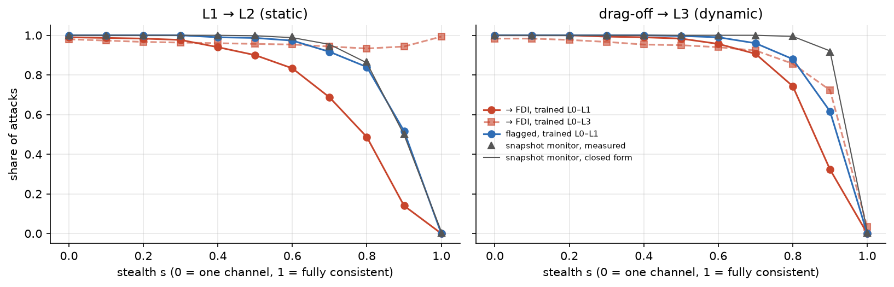

# Lesson 4 · When the attacker knows the physics

> Lesson 3 ended with a classifier that tells faults from false data almost perfectly, for
> every attack that breaks a physical relation. This lesson attacks that result on purpose.
> It turns sophistication into a dial, from one-channel offsets to fully consistent
> injections, and measures where detection breaks. It lets the attacker copy a fault. And it
> measures the number CPS-02 had to assume: how often the integrity check misses a spoofed
> navigation solution. The point is not that detection fails eventually, which everyone
> expects, but *where*, *why*, and *what it would take to push the limit back*.

**Code:** [`src/fdicps/adversarial_robustness_analysis/`](../../src/fdicps/adversarial_robustness_analysis/),
[`cross_sensor_consistency_model/wls.py`](../../src/fdicps/cross_sensor_consistency_model/wls.py) ·
**Tests:** [`tests/test_robustness.py`](../../tests/test_robustness.py) ·
**Results:** [`validation/results/robustness.md`](../../validation/results/robustness.md) ·
**Previous:** [Lesson 3](03-reading-physics-in-an-anomaly.md) ·
**Next:** [Lesson 5](05-state-estimation-as-a-lie-detector.md)

## Learning objectives

By the end of this lesson you should be able to:

1. State the distribution of the weighted-least-squares bad-data statistic with and without an
   attack, and compute a detection probability from the noncentral chi-square law.
2. Show that the noncentrality of a blended attack falls as $(1-s)^{2}$, and use it to predict a
   detection curve before running any simulation.
3. Set a per-test level that gives an exact scenario false-alarm rate.
4. Explain, with Bayes' rule, why an attack that reproduces a fault's effect cannot be
   attributed by any detector, and what that says about the fault model.
5. Read the integrity-monitor miss table and explain why receivers-only spoofing is missed
   about half the time by a snapshot check.

---

## 1. Sophistication as a dial

Lessons 1 to 3 used four discrete levels. Here the same attacks are blended continuously:

```math
a(s) = s\,A + (1 - s)\,A_{\text{target}}, \qquad s \in [0, 1],
```

so that at every $s$ the injection on the target channel, the attacker's intended effect, is the
same. Two paths are swept, with 300 paired attacks per point (same seeds, same flights, same
offsets):

* **static**: from L1 (one receiver's position) at $s = 0$ to L2 ($a = Hc$ on every position channel)
  at $s = 1$;
* **dynamic**: from a single-channel drag-off at $s = 0$ to L3 (the drag-off on every channel,
  INS included) at $s = 1$.

## 2. The snapshot monitor, in closed form

On each axis the position and velocity channels obey $z = Hx + e$ with $e \sim N(0, R)$ and
$W = R^{-1}$. Weighted least squares gives the residual $r = Sz$ with
$S = I - H(H^{\top}WH)^{-1}H^{\top}W$, and the bad-data statistic

```math
J = r^{\top} W r \sim \chi^{2}_{m-n} \quad \text{(healthy)}, \qquad
J \sim \chi^{2}_{m-n}(\lambda),\ \lambda = a^{\top} W S a \quad \text{(attack } a\text{)}.
```

Here $m - n$ is 2 along-track and 3 vertically. The noncentral law follows because $S$ is a
$W$-orthogonal projection of rank $m - n$, so $W^{1/2} r$ is a standard normal vector projected onto an
$(m-n)$-dimensional subspace, shifted by the projection of $W^{1/2} a$.

### Why the dial gives $(1-s)^{2}$

$SA = 0$ because $A$ is in the range of $H$ at every instant (Lesson 1). So
$S a(s) = (1 - s) S A_{\text{target}}$ and

```math
\lambda(s) = (1 - s)^{2}\,\lambda(0).
```

Detectability is a deterministic, decreasing function of stealth. A Hypothesis test checks this for
random attacks, including that $\lambda$ never rises with $s$.

### An exact scenario false-alarm rate

A scenario runs $2T = 600$ snapshot tests (300 samples, two axes). Noise is white and the axes
share no channel, so the tests are independent, and a per-test level

```math
\alpha = 1 - (1 - F)^{1/2T}
```

gives a scenario false-alarm rate of exactly $F$. With $F$ = 1 %, $\alpha = 1.68 \times 10^{-5}$. The scenario
detection probability is then $1 - \prod_{t}(1 - P_{t})$, with each $P_{t}$ a noncentral chi-square tail.

The results compare this closed form with the measured alarm rate over the 300 attacks at every
$s$. They agree within sampling error everywhere, for example:

| path | $s$ | measured | closed form |
|---|---|---|---|
| static | 0.7 | 0.943 | 0.954 |
| static | 0.8 | 0.867 | 0.861 |
| static | 0.9 | 0.503 | 0.498 |
| static | 1 | 0.003 | 0.01 |

At $s = 1$ the closed form is exactly the false-alarm rate, the Liu, Ning and Reiter result; 1 alarm
in 300 is consistent with it.

## 3. The classifier on the dial



Two classifiers are compared. One is trained on L0 and L1 only: a defender who has seen crude
attacks and nothing else. The other is trained on all four levels.

| path | $s$ | → FDI (trained L0–L1) | flagged (trained L0–L1) | → FDI (trained L0–L3) |
|---|---|---|---|---|
| static | 0.5 | 0.9 | 0.987 | 0.957 |
| static | 0.8 | 0.487 | 0.84 | 0.933 |
| static | 0.9 | 0.14 | 0.517 | 0.943 |
| static | 1 | 0 | 0 | 0.993 |
| dynamic | 0.8 | 0.743 | 0.88 | 0.857 |
| dynamic | 0.9 | 0.323 | 0.617 | 0.723 |
| dynamic | 1 | 0 | 0 | 0.033 |

Three lessons:

* **The breakdown point.** For the crude-trained classifier, attribution falls below one half at
  $s = 0.8$ on the static path and $s = 0.9$ on the dynamic one. Up to $s = 0.7$ it holds: an attacker
  must respect most of the physics before attribution fails.
* **Training on what you fear helps, up to a wall.** The fully trained classifier keeps
  attributing the static path all the way to L2 (0.993 at $s = 1$), because L2 breaks both receivers'
  kinematics and it has seen that. On the dynamic path it cannot: at $s = 1$ there is nothing to see.
* **"Flagged" tracks the snapshot monitor.** On the static path the crude-trained classifier's
  flag rate follows the closed-form snapshot curve closely: both are limited by the same
  noncentrality.

## 4. An attacker who copies a fault

Suppose the attacker reproduces exactly the effect of a receiver bias fault. Then the
telemetry $x$ has the same distribution under "attack" and "fault": $p(x \mid \text{FDI}) = p(x \mid \text{fault})$.
Bayes' rule gives

```math
\frac{P(\text{FDI} \mid x)}{P(\text{fault} \mid x)} = \frac{p(x \mid \text{FDI})}{p(x \mid \text{fault})}\cdot\frac{\pi_{\text{FDI}}}{\pi_{\text{fault}}} = \frac{\pi_{\text{FDI}}}{\pi_{\text{fault}}}.
```

The data change nothing: the best possible attribution is the prior. No classifier, however
powerful, can do better. The results confirm the extreme case:

| scenarios (300 each) | → normal | → fault | → FDI |
|---|---|---|---|
| real receiver bias fault | 0 | 1 | 0 |
| near mimic: fault-sized step on one channel | 0 | 0.01 | 0.99 |
| exact mimic: a receiver bias reproduced by the attacker | 0 | 1 | 0 |

The near mimic, a step of fault size on one receiver's position on *one* axis, is still caught:
the fault model says a receiver bias moves the receiver's position on both axes at once. That
detail is an assumption about how receivers fail, and an attacker who knew it would copy it.
**Fault-versus-attack attribution is only as good as the fault model**, and only against attackers
who do not know it.

## 5. The number CPS-02 had to assume

CPS-02's attack tree gives the navigation integrity cross-check a 0.1 probability of missing a
spoofed solution (`integrity_monitor_miss`). Here it is measured, for the snapshot monitor and
for the fully trained classifier:

| attack | P(miss), snapshot monitor | P(miss), classifier |
|---|---|---|
| L0 | 0 | 0 |
| L1 | 0 | 0 |
| L2 | 1 | 0 |
| L3 | 0.992 | 0.992 |
| L3, receivers only (`gnss_spoof`) | 0.507 | 0.507 |
| L3, whole bus (bus injection) | 0.997 | 0.967 |

The answer depends entirely on the attack. Against crude attacks the miss probability is zero, far
better than 0.1. Against the snapshot monitor, L2 is never caught. Against both monitors, a
drag-off that also rewrites the inertial and air data is almost never caught.

The receivers-only spoof is the instructive row. It moves only the two GNSS receivers. On the
vertical axis the baro, untouched, disagrees with them, and the snapshot check catches it; on the
along-track axis there is no dissimilar position source, so it cannot. Hence about half. The INS,
untouched as well, *does* contradict the spoof on both axes (the velocity changes while the
accelerometers feel nothing), but the snapshot check does not use the INS, and the classifier never
saw this pattern in training. A model that uses the INS as a witness over time, a Kalman filter,
should do better: Lesson 5 tests that.

For CPS-02 the consequence is concrete: the 0.1 should be replaced by a miss probability that
depends on the attacker's reach, from 0 for crude attacks to about 0.5 for receivers-only spoofing
and nearly 1 for a bus-level, fully consistent injection.

## 6. Worked example

A 100 m offset on receiver 1's altitude, blended towards the same 100 m on every altitude source:

```python
import numpy as np

from fdicps.adversarial_robustness_analysis.monitors import per_test_level
from fdicps.cross_sensor_consistency_model.navigation import snapshot_models
from fdicps.dual_anomaly_data_generation.parameters import load_sensor_parameters

P = load_sensor_parameters()
idx, wls = snapshot_models(P)[1]  # vertical axis: 2 receivers (pos, vel) + baro
alpha = per_test_level(0.01, 2 * P.n_steps)  # 1 % per scenario over 600 tests
a_one = np.array([100.0, 0, 0, 0, 0])  # 100 m on receiver 1's altitude only
a_all = wls.H @ np.array([100.0, 0.0])  # the same 100 m on every altitude source
print(f"per-test level alpha = {alpha:.2e}, threshold = {wls.threshold(alpha):.1f}")
for s in (0.0, 0.5, 0.8, 0.9, 0.95, 1.0):
    a = s * a_all + (1 - s) * a_one
    lam = float(wls.noncentrality(a))
    p = float(wls.detection_probability(a, alpha))
    print(f"s = {s:4.2f}: lambda = {lam:7.2f}, P(one test alarms) = {p:.3f}")
# per-test level alpha = 1.68e-05, threshold = 24.8
# s = 0.00: lambda =  196.01, P(one test alarms) = 1.000
# s = 0.50: lambda =   49.00, P(one test alarms) = 0.986
# s = 0.80: lambda =    7.84, P(one test alarms) = 0.028
# s = 0.90: lambda =    1.96, P(one test alarms) = 0.001
# s = 0.95: lambda =    0.49, P(one test alarms) = 0.000
# s = 1.00: lambda =    0.00, P(one test alarms) = 0.000
```

The $\lambda$ column is $196.01 \times (1-s)^{2}$ exactly. A single test at $s = 0.8$ alarms with probability 0.028,
but an attack held for 150 samples gets 150 chances: $1 - (1 - 0.0277)^{150} = 0.985$. At $s = 0.9$ a single test
alarms with probability 0.00063 and 150 tests give only 0.091. Persistence helps the defender, but
only while $\lambda$ is not too small, and $\lambda$ falls quadratically in the attacker's care.

## 7. Code walkthrough

* [`wls.py`](../../src/fdicps/cross_sensor_consistency_model/wls.py): `WLS` with `statistic()`,
  `threshold()`, `noncentrality()` and `detection_probability()`, for any linear model.
* [`navigation.py`](../../src/fdicps/cross_sensor_consistency_model/navigation.py):
  `snapshot_models()` and `snapshot_statistics()` for the chain's two axes.
* [`monitors.py`](../../src/fdicps/adversarial_robustness_analysis/monitors.py):
  `per_test_level()`, `snapshot_alarm()` and the closed-form `snapshot_scenario_detection()`.
* [`attacks.py`](../../src/fdicps/adversarial_robustness_analysis/attacks.py): the paired
  `consistency_sweep()`, `near_mimic()`, `exact_mimic()` and `spoofer_variant()`.

## Exercises

1. Show that $\lambda = a^{\top}WSa$ equals $\lVert W^{1/2} S a \rVert^{2}$, using $S^{\top}WS = WS$.
2. With $F$ = 1 % over 600 tests, how much smaller is the exact per-test level than the Bonferroni
   level $F/600$? Why does it barely matter here?
3. An attack has $\lambda(0) = 50$ on the vertical axis. At which $s$ does a single test at the per-test level
   above alarm with probability one half? (Use the noncentral chi-square median, or reason with
   $\lambda$ and the threshold 24.8.)
4. Explain why the crude-trained classifier's *attribution* breaks earlier than its *detection* on the
   static path.
5. A defender adds a third GNSS receiver on the same bus. Which rows of the miss table change?
6. Write the Bayes argument of Section 4 for an attacker who copies a fault only *approximately*,
   with $p(x \mid \text{FDI}) = 2 p(x \mid \text{fault})$ on some region of $x$. What is the posterior odds ratio there?

### Solutions

1. $S^{\top}WS = W S$ because $WS$ is symmetric and $S$ is idempotent ($S^{2} = S$). Then
   $\lVert W^{1/2}Sa \rVert^{2} = a^{\top}S^{\top}WSa = a^{\top}WSa$.
2. Exact: $1.675 \times 10^{-5}$; Bonferroni: $1.667 \times 10^{-5}$. They differ by 0.5 %, because for small $F$ the
   expansion $1 - (1-F)^{1/n} \approx F/n + F^{2}(n-1)/(2n^{2})$ has a tiny second term. The exact form matters
   only for large $F$.
3. $\lambda(s) = 50(1-s)^{2}$. One half needs the noncentral mean $3 + \lambda$ to sit roughly at the
   threshold, $\lambda \approx 22$, so $(1-s)^{2} \approx 0.44$ and $s \approx 0.34$. Solving the noncentral tail
   exactly gives $\lambda = 22.8$ and $s = 0.32$: the median of $\chi^2_3(\lambda)$ sits slightly below its mean.
4. Detection only needs the anomaly to be big; attribution needs the classifier to recognise the
   pattern as *attack-like*. As $s$ grows, the single-channel disagreement it learned on L1 shrinks
   while the coordinated part it never saw grows, so the pattern stops looking like anything it was
   taught before it stops looking anomalous.
5. None of the attack rows. A third receiver on the same bus is reachable by the same bus-level
   attacker, and an RF spoofer moves all receivers alike. It adds a row to $H$ of the same kind, so
   $a = Hc$ is still possible. Only a dissimilar source *outside the attacker's reach* changes them.
6. The odds become $2 \pi_{\text{FDI}}/\pi_{\text{fault}}$: the data shift the odds by a factor of 2 only.
   Approximate mimicry leaves a weak, quantifiable signal; how weak is set by how well the attacker
   knows the fault model.

## References

* Y. Liu, P. Ning and M. K. Reiter, "False data injection attacks against state estimation in
  electric power grids," *Proc. ACM CCS*, 2009.
* A. Monticelli, *State Estimation in Electric Power Systems: A Generalized Approach*, Kluwer, 1999
  (the chi-square bad-data test).
* N. L. Johnson, S. Kotz and N. Balakrishnan, *Continuous Univariate Distributions*, vol. 2, 2nd
  ed., Wiley, 1995 (the noncentral chi-square distribution).
* Y. Bar-Shalom, X. R. Li and T. Kirubarajan, *Estimation with Applications to Tracking and
  Navigation*, Wiley, 2001.
