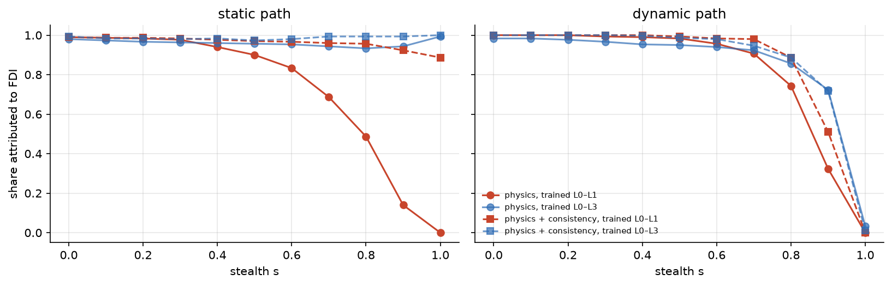

# Lesson 5 · State estimation as a lie detector

> A state estimator does more than average sensors: it holds them to a model. The
> snapshot check of Lesson 4 holds them to *one instant* of geometry, and an attacker who
> shifts every position together passes it. A Kalman filter holds them to the *dynamics*:
> the inertial sensors say how the aircraft can have moved since the last sample, and every
> new measurement is compared with that prediction. This lesson builds that filter, turns its
> innovations into tests with exact false-alarm rates, and measures what it buys: L2 caught
> every time, receivers-only spoofing caught almost every time. Then it states, and proves,
> the one thing no model-based check can catch, and what a sensor out of the attacker's reach
> does about it. The same estimator code, run on the IEEE 14-bus power system, reproduces the
> result that started the field.

**Code:** [`src/fdicps/cross_sensor_consistency_model/`](../../src/fdicps/cross_sensor_consistency_model/) ·
**Data:** [`ieee14_branches.csv`](../../src/fdicps/data/ieee14_branches.csv) ·
**Tests:** [`tests/test_consistency.py`](../../tests/test_consistency.py) ·
**Results:** [`validation/results/consistency.md`](../../validation/results/consistency.md) ·
**Previous:** [Lesson 4](04-when-the-attacker-knows-the-physics.md) ·
**Next:** [Lesson 6](06-testing-on-someone-elses-plant.md)

## Learning objectives

By the end of this lesson you should be able to:

1. Write the Kalman filter of an axis with an inertial-bias state, derive its process noise,
   and check its steady state against the discrete algebraic Riccati equation.
2. Explain why the normalised innovation squared is chi-square and independent in time, and
   build per-sample, block and CUSUM monitors from it.
3. Explain why the filter catches L2 and receivers-only spoofing, and prove that it cannot
   catch an injection that is a trajectory of its own model.
4. Say exactly what a dissimilar sensor outside the attacker's reach protects, and what it
   does not.
5. Run the same weighted-least-squares code on the IEEE 14-bus DC model and count the meters a
   stealthy attacker must alter.

---

## 1. From a snapshot to a story

The snapshot check asks: *are these numbers consistent with each other, now?* An attack
$a = Hc$ answers yes. But the aircraft has a past. Its position now must equal its position a
second ago plus what its velocity and acceleration did in between, and the accelerometers
measured that acceleration. A filter that carries the past forward asks a harder question: *are
these numbers consistent with each other, now, and with everything the aircraft could have done
since?*

## 2. The filter

### Model

On each axis the state is $x = [p, v, b]$, with $b$ the mean bias of the two accelerometers. The
mean measured acceleration $u_{k} = a_{k} + b + n_{k}$ drives the prediction with Lesson 1's exact
kinematics, the bias subtracted:

```math
x_{k+1} = F x_{k} + G u_{k} + w_{k}, \qquad
F = \begin{bmatrix} 1 & \Delta t & -\Delta t^{2}/2 \\ 0 & 1 & -\Delta t \\ 0 & 0 & 1 \end{bmatrix}, \quad
G = \begin{bmatrix} \Delta t^{2}/2 \\ \Delta t \\ 0 \end{bmatrix}.
```

The process noise is the accelerometer noise pushed through $G$. The mean of two independent
noises of variance $\sigma_{a}^{2}$ has variance $\sigma_{a}^{2}/2$, so

```math
Q = G G^{\top} \frac{\sigma_{a}^{2}}{2} + \operatorname{diag}(0, 0, q_{b}),
```

with a tiny bias random walk $q_{b} = 10^{-10}$ that keeps the bias mode stabilisable. The
measurements are the receivers' positions and velocities and, vertically, the baro:
$z = Hx + e$, $e \sim N(0, R)$.

### Recursion

With prior $\hat x_{k}^{-}$ and covariance $P_{k}^{-}$:

```math
\nu_{k} = z_{k} - H\hat{x}^{-}_{k}, \quad S_{k} = HP^{-}_{k}H^{\top} + R, \quad K_{k} = P^{-}_{k}H^{\top}S_{k}^{-1},
```

```math
\hat{x}_{k} = \hat{x}^{-}_{k} + K_{k}\nu_{k}, \quad
P_{k} = (I - K_{k}H)P^{-}_{k}(I - K_{k}H)^{\top} + K_{k}RK_{k}^{\top},
```

```math
\hat{x}^{-}_{k+1} = F\hat{x}_{k} + G u_{k}, \quad P^{-}_{k+1} = FP_{k}F^{\top} + Q.
```

The covariance update is in Joseph form, which stays symmetric and positive definite under
rounding. $P$, $S$ and $K$ do not depend on the data, so the code computes them once and runs the
state recursion for all scenarios at once.

### Steady state

The prior covariance converges to the solution of the discrete algebraic Riccati equation,

```math
P = FPF^{\top} - FPH^{\top}(HPH^{\top} + R)^{-1}HPF^{\top} + Q.
```

The bias mode has almost no process noise, so convergence is slow: after 20 000 steps the
recursion matches SciPy's `solve_discrete_are` to rounding (relative gap below $10^{-12}$). In steady state the filter
knows position to 0.41 m (along-track) and 0.43 m (vertical), against 3.3 m and 6.6 m for one
receiver: the INS carries information forward that one snapshot does not have.

## 3. Innovations as tests

When the model holds, the innovations are independent in time and $\nu_{k} \sim N(0, S_{k})$ (the
innovations property of the Kalman filter), so the normalised innovation squared is

```math
\text{NIS}_{k} = \nu_{k}^{\top} S_{k}^{-1} \nu_{k} \sim \chi^{2}_{m}.
```

On the test normals its mean is 4.009 along-track ($m = 4$) and 4.994 vertically ($m = 5$). Three
monitors use it, each set to a 1 % scenario false-alarm rate:

* **per sample**: every NIS after the 60-s reference, on both axes, at the per-test level of
  Lesson 4 (exact, because the tests are independent);
* **20-s blocks**: the sum of NIS over non-overlapping blocks of 20 samples is $\chi^2_{20m}$, and
  blocks are independent, so the same exact construction applies. A small excess that no
  single sample shows adds up here;
* **CUSUM** (Page, 1954): with $N_{k}$ the NIS, $g_{k} = \max(0, g_{k-1} + N_{k} - 1.5m)$. It reacts fastest to a
  persistent excess, but its false-alarm rate has no simple closed form, so its threshold is
  the 99th percentile on training normals.

Measured false-alarm rates on the 500 test normals: 0.012, 0.016 and 0.018, against 0.008 for
the snapshot check; all within sampling error of 0.01.

## 4. What the filter catches

| scenarios | snapshot WLS | KF NIS, per sample | KF NIS, 20-s blocks | KF CUSUM |
|---|---|---|---|---|
| physical faults | 0.586 | 0.83 | 0.928 | 0.92 |
| L0 | 1 | 1 | 1 | 1 |
| L1 | 1 | 1 | 1 | 1 |
| L2 | 0 | 1 | 1 | 1 |
| L3 | 0.008 | 0.024 | 0.008 | 0.032 |
| L3 drag-off, reach: receivers | 0.493 | 0.817 | 0.97 | 0.96 |
| L3 drag-off, reach: bus | 0.003 | 0 | 0.01 | 0 |
| L3 drag-off, reach: bus, air data protected | 0.493 | 0.493 | 0.5 | 0.493 |

* **L2 is caught every time.** Both receivers' positions move while their velocities and the
  INS say nothing moved. The prediction disagrees with the measurement by the offset.
* **Receivers-only spoofing is caught 97 % of the time** (20-s blocks), against 49 % for the
  snapshot check. The receivers' velocity changes while the accelerometers feel nothing: the
  INS is the witness. Per sample it is caught 82 % of the time; summing over blocks catches the
  slow drags too.
* **A bus-level drag-off is never caught**, beyond the false-alarm rate, by any monitor.

## 5. Why the bus-level drag-off is invisible: the theorem

Let the attacker add, at every step, $a_{k}$ to the measurements and $\delta u_{k}$ to the inertial input,
chosen so that

```math
a_{k} = H c_{k}, \qquad c_{k+1} = F c_{k} + G\,\delta u_{k}, \qquad c_{0} = 0.
```

The filter is linear. Write its estimate on the attacked data as the clean estimate plus a
response $d_{k}$, driven only by the attack. The response's innovation is
$a_{k} - Hd_{k}^{-}$ and its prediction is $d_{k+1}^{-} = F d_{k} + G \delta u_{k}$. Suppose $d_{k}^{-} = c_{k}$. Then the
response's innovation is $Hc_{k} - Hc_{k} = 0$, so $d_{k} = d_{k}^{-} = c_{k}$, and $d_{k+1}^{-} = Fc_{k} + G \delta u_{k} = c_{k+1}$.
Since $d_{0}^{-} = c_{0} = 0$, induction gives a zero response innovation at every step:

* **every innovation is exactly the clean one**, so no function of the innovations can detect
  the attack; and
* **the estimate is carried away by exactly $c_{k}$**: the attacker's chosen trajectory error.

This is the dynamic version of $a = Hc$, the setting Mo and Sinopoli (2010) studied for control
systems with a Kalman filter and a failure detector. A test checks both bullets numerically
(innovations equal to $10^{-8}$, estimate offset equal to the injected position). The L3 attack of
this project is exactly such a $c_{k}$, which is why nothing caught it.

The theorem also says what would break it: any measurement the attacker cannot change. Then
that row of $a_{k}$ is forced to zero, and $a_{k} = Hc_{k}$ requires $c_{k}$ to have no component that row
sees.

## 6. A dissimilar sensor protects what it measures

The baro measures altitude. If it travels on a path the attacker cannot write to:

| attacker reach | attacked axis | detected (KF NIS, 20-s blocks) |
|---|---|---|
| bus | along-track | 0.013 |
| bus | vertical | 0.007 |
| bus, air data protected | along-track | 0.013 |
| bus, air data protected | vertical | 1 |

Every vertical drag-off is caught, and no along-track one. A witness protects exactly the
directions of state it observes. To close the along-track gap the chain would need an
independent along-track position or velocity source that the bus-level attacker cannot reach
(an air-data true airspeed with wind uncertainty, for instance, or a separately routed third
navigation source): a design choice, not a detection algorithm.

## 7. The classifier, with consistency features

Fourteen features summarise the monitors (the largest snapshot statistic, NIS, block sum and
CUSUM per axis; the largest rolling innovation on position and on velocity channels; the drift of
the bias estimate). Added to Lesson 3's 52:

| features | path | breakdown s (trained L0–L1) | → FDI at s = 0.9 (trained L0–L1) |
|---|---|---|---|
| physics | static | 0.8 | 0.14 |
| physics + consistency | static | none | 0.923 |
| physics | dynamic | 0.9 | 0.323 |
| physics + consistency | dynamic | 1 | 0.51 |



And the integrity-monitor question of Lesson 4, for the fully trained classifier:

| features | attacker reach | → normal (missed) | → FDI |
|---|---|---|---|
| physics | receivers | 0.507 | 0.31 |
| physics + consistency | receivers | 0.03 | 0.817 |
| physics + consistency | bus | 0.99 | 0.01 |
| physics + consistency | bus, air data protected | 0.5 | 0.5 |

The consistency features remove the static breakdown entirely, delay the dynamic one to the
end of the dial, and cut the receivers-only miss probability from 0.51 to 0.03. On the standard
test set they change little (accuracy 0.907 to 0.911), because Lesson 3's features already
caught L0 to L2: their value is against the attacks the defender has *not* trained on.

## 8. The same code on a power grid

The FDI literature began with power-grid state estimation. In the DC approximation the real
power flow on a branch from bus $i$ to bus $j$ is $(\theta_{i} - \theta_{j})/(x t)$, with reactance $x$ and transformer
tap $t$, and a bus injection is the sum of the flows leaving it. The IEEE 14-bus system (branch
data from MATPOWER's `case14`) gives 20 flow meters and 14 injection meters against 13 angles
(bus 1 is the reference): $m = 34$, $n = 13$, rank 13, and 21 degrees of freedom. The
navigation chain's `WLS` class runs on it unchanged:

| attack | noncentrality λ | P(detect), closed form | P(detect), Monte Carlo |
|---|---|---|---|
| one meter, 0.05 p.u. | 17.76 | 0.461 | 0.463 |
| one meter, 0.10 p.u. | 71.05 | 1 | 1 |
| three meters, 0.03 p.u. each | 14.17 | 0.325 | 0.321 |
| a = Hc (stealthy) | 0 | 0.01 | 0.011 |

A stealthy attack that shifts one bus angle alone must alter every meter that sees that angle:
the nonzeros of column $j$ of $H$.

| bus | 2 | 3 | 4 | 5 | 6 | 7 | 8 | 9 | 10 | 11 | 12 | 13 | 14 |
|---|---|---|---|---|---|---|---|---|---|---|---|---|---|
| meters to alter | 9 | 5 | 11 | 9 | 9 | 7 | 3 | 9 | 5 | 5 | 5 | 7 | 5 |

Bus 8 hangs off bus 7 alone, so three meters suffice: its branch flow and the two end
injections. The defender's version of the same table says which meters are worth protecting:
securing one meter in each column's support raises the attacker's cost the most where the
column is sparse.

## 9. Worked example

Along-track has no baro, so the INS is the only witness. Run the filter on one segment, clean
and under three attacks that all start at 150 s:

```python
import numpy as np

from fdicps.cross_sensor_consistency_model.kalman import axis_model, run_filter
from fdicps.dual_anomaly_data_generation.fdi import FalseDataInjection, apply_fdi
from fdicps.dual_anomaly_data_generation.parameters import load_sensor_parameters
from fdicps.dual_anomaly_data_generation.scenarios import make_scenario

P = load_sensor_parameters()
clean = make_scenario(1_000_007, "normal").values
model = axis_model(P, 0)  # along-track: no baro, the INS is the only witness
attacks = {
    "L2: 100 m over 15 s": FalseDataInjection(2, "offset", 0, 150, 100.0, 15.0, target=0),
    "L3, receivers only": FalseDataInjection(
        3, "drag", 0, 150, 0.05, 60.0, target=0, include_baro=False, include_ins=False
    ),
    "L3, whole bus": FalseDataInjection(3, "drag", 0, 150, 0.05, 60.0, target=0),
}
base = run_filter(clean[None], P, model).nis[0]
print(f"{'attack':22s} {'peak NIS':>9s} {'NIS sum 150-169':>16s} {'NIS sum 190-209':>16s}")
print(
    f"{'none':22s} {base[60:].max():9.1f} {base[150:170].sum():16.1f} {base[190:210].sum():16.1f}"
)
for name, fdi in attacks.items():
    nis = run_filter(apply_fdi(clean, fdi, P)[None], P, model).nis[0]
    print(f"{name:22s} {nis[60:].max():9.1f} {nis[150:170].sum():16.1f} {nis[190:210].sum():16.1f}")
# attack                  peak NIS  NIS sum 150-169  NIS sum 190-209
# none                        14.5             79.7             77.9
# L2: 100 m over 15 s       1220.6          11593.9           3148.6
# L3, receivers only          29.8            224.9            245.7
# L3, whole bus               14.5             79.7             77.9
```

A 20-sample block sum is $\chi^2_{80}$ when the model holds: median 79.3, 1 % tail 112.3. The clean
blocks sit at the median. L2 is three orders of magnitude out. The receivers-only drag-off
(0.05 m/s² for 60 s) never makes a single sample look extreme (peak NIS 29.8), but each block is
twice the 1 % tail. The bus-level drag-off reproduces the clean numbers to the printed digit,
as the theorem says it must.

## 10. Code walkthrough

* [`kalman.py`](../../src/fdicps/cross_sensor_consistency_model/kalman.py): `axis_model()`
  ($F$, $G$, $Q$, $H$, $R$), `gains()` (the data-independent covariance recursion, Joseph form),
  `run_filter()` (all scenarios at once) and `steady_state_prior()` (the DARE).
* [`detection.py`](../../src/fdicps/cross_sensor_consistency_model/detection.py):
  `filter_axes()`, `nis_alarm()`, `window_alarm()`, `cusum()` and `consistency_features()`.
* [`ieee14.py`](../../src/fdicps/cross_sensor_consistency_model/ieee14.py):
  `measurement_matrix()`, `model()` and `meters_to_move_one_state()`.
* [`wls.py`](../../src/fdicps/cross_sensor_consistency_model/wls.py): the estimator both systems
  share.

## Exercises

1. Derive $Q$ for a single accelerometer instead of the mean of two. Which steady-state numbers
   would change, and in which direction?
2. Why must the filter's covariance be computed before it can be used to set exact per-sample
   thresholds, and why does it not matter that it depends on time early in the segment?
3. Prove that the response innovation is zero for $a_{k} = Hc_{k}$ with $c_{k+1} = Fc_{k}$ and no
   inertial injection. What kind of attack is that, physically?
4. In the receivers-only spoof, the bias state could absorb the discrepancy as a change of
   accelerometer bias. What limits how fast it does, and what would happen with $q_{b}$ a
   thousand times larger?
5. On the IEEE 14-bus system, an attacker can alter only meters 1 to 20 (the flows). Can they
   shift bus 8's angle stealthily? Why or why not?
6. A designer proposes a third GNSS receiver on a separate antenna but on the same data bus.
   Using Section 5, does it change the bus-level row of the table?

### Solutions

1. $Q = GG^{\top}\sigma_{a}^{2}$, twice as large. The filter would trust its prediction less, so the steady
   prior position and velocity uncertainties would grow (by up to a factor of $\sqrt{2}$ in the
   process-noise-dominated directions), and the innovations' covariance $S$ would grow with them.
2. The thresholds are on $\nu^{\top}S^{-1}\nu$, which needs $S_{k}$; but $S_{k}$ is exact at every $k$, transient
   included, because it is computed from the model, not estimated from data. NIS is
   $\chi^2_{m}$ at every step, not only in steady state. (The 60-s reference skip only keeps the
   loose initial prior out of the tests.)
3. It is the case $\delta u_{k} = 0$ of Section 5: the same induction holds. Physically, $c_{k+1} = Fc_{k}$ with
   $c_{0} = 0$ means $c_{k} = 0$ for all $k$, so there is no such non-trivial attack starting from zero:
   with $\delta u = 0$, a dynamically consistent offset must start already present (for example a
   constant velocity offset from the beginning). Starting an attack mid-flight requires the
   inertial injection.
4. The bias random walk $q_{b}$ sets the bias state's process noise, so its steady-state
   uncertainty and gain ($\sigma_{b} \approx 3.8 \times 10^{-4}$ m/s²): the filter refuses to believe the bias moved
   by 0.05 m/s² quickly. With $q_{b}$ a thousand times larger, the bias would track such changes
   faster, part of the spoof would be explained away as a bias shift, and detection would fall:
   tuning a filter for robustness to real bias changes trades against this attack.
5. No. Column 7 of $H$ (bus 8) has nonzeros in flow 14 (branch 7–8) and in the injections of
   buses 7 and 8. With injections out of reach, $a = He_{7}$ cannot be produced, and any attack
   restricted to flows that is in the range of $H$ needs $c$ with $H_{\mathrm{inj}} c = 0$: for a
   connected network that forces equal angle shifts everywhere, which bus 1's reference
   rules out.
6. No. The bus-level attacker can write the third receiver's values too, so its rows join $H$ and
   $a_{k} = Hc_{k}$ is still achievable. A new antenna helps against an RF spoofer, not against the bus.

## References

* R. E. Kalman, "A new approach to linear filtering and prediction problems," *Journal of Basic
  Engineering* 82(1), 1960.
* Y. Bar-Shalom, X. R. Li and T. Kirubarajan, *Estimation with Applications to Tracking and
  Navigation*, Wiley, 2001 (NIS consistency tests, Joseph form).
* E. S. Page, "Continuous inspection schemes," *Biometrika* 41(1/2), 1954 (CUSUM).
* Y. Mo and B. Sinopoli, "False data injection attacks in control systems," *First Workshop on
  Secure Control Systems*, CPS Week, 2010.
* Y. Liu, P. Ning and M. K. Reiter, "False data injection attacks against state estimation in
  electric power grids," *Proc. ACM CCS*, 2009.
* R. D. Zimmerman, C. E. Murillo-Sánchez and R. J. Thomas, "MATPOWER: steady-state operations,
  planning, and analysis tools for power systems research and education," *IEEE Transactions on
  Power Systems* 26(1), 2011 (`case14`, `makeBdc`).
