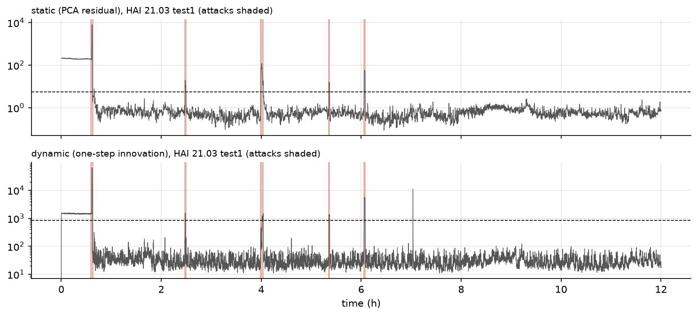

# Lesson 6 · Testing on someone else's plant

> Everything so far ran on data this project generated, so every result is conditional on
> its own models. This lesson takes the detection layer to a real industrial testbed, HAI,
> where the plant, the sensors and the attacks were made by someone else. There is no physical
> model of that plant here, so the two consistency checks are rebuilt from data. They catch
> most attacks; they also raise a long false alarm that turns out to be an operating point
> they had never seen. That alarm is the most instructive result of the lesson.

**Code:** [`src/fdicps/transfer/`](../../src/fdicps/transfer/) ·
**Tests:** [`tests/test_transfer.py`](../../tests/test_transfer.py) ·
**Results:** [`validation/results/hai_transfer.md`](../../validation/results/hai_transfer.md) ·
**Data:** HAI 21.03, fetched by `uv run python -m fdicps.transfer.fetch` (about 54 MB, never committed) ·
**Previous:** [Lesson 5](05-state-estimation-as-a-lie-detector.md) ·
**Next:** [Lesson 7](07-what-is-and-isnt-new.md)

## Learning objectives

By the end of this lesson you should be able to:

1. Describe the HAI dataset, what it labels and what it does not, and handle it reproducibly
   (pinned version, integrity check, no redistribution).
2. Explain the principal-subspace residual (SPE) as a data-driven version of the
   weighted-least-squares bad-data test, and a one-step linear predictor as a data-driven
   version of the Kalman innovation.
3. Read per-second and per-event detection results, and say why they differ.
4. Diagnose a false alarm by its residual contributions, and explain why a data-driven check
   cannot tell a new operating point from an attack.
5. State exactly which of this project's results transfer to HAI and which cannot be tested
   on it.

---

## 1. The dataset

HAI (HIL-based Augmented ICS security dataset) comes from the Affiliated Institute of ETRI. A
testbed of a boiler, a turbine and a water-treatment process is coupled to a hardware-in-the-loop
power-plant simulator, and its control-system points are logged once a second during normal
operation and during labelled attacks. Version 21.03 is used: plain gzip CSV files, a whole-system
`attack` label and per-process labels `attack_P1` to `attack_P3`. Its README gives the licence as
CC BY-SA 4.0 (the repository metadata says CC BY 4.0); both allow research use with attribution.

Three files are used: `train1` (60 hours of normal operation) for fitting, and `test1` (12 hours,
5 attacks) and `test2` (33 hours, 20 attacks) for testing. The fetch script downloads them from the
dataset repository pinned to one commit and checks each against the SHA-1 that git stores for it
(the SHA-1 of the bytes `blob <size>`, a zero byte, then the content), read from the repository's
API beforehand. The data are never committed or redistributed; only aggregate results are.

**What HAI cannot test.** It labels attacks, not physical faults. The central question of this
project, fault or attack, cannot be evaluated on it. Only the detection layer can.

## 2. From physics to data

### The static check

In Lesson 4 the measurements obeyed $z = Hx + e$ with $H$ known, and the bad-data test measured the
residual outside the range of $H$. Without a model, estimate that range from normal data. Standardise
the 58 tags that vary in training to $z$ (zero mean, unit variance) and take the principal subspace
$V$ (the leading right singular vectors) that explains 99 % of the variance; here that is 30
components. The squared prediction error

```math
\text{SPE} = \lVert (I - VV^{\top}) z \rVert^{2}
```

is the residual outside the learned subspace (the Q statistic of Jackson and Mudholkar, 1979). If
the tags really were $Hx + e$ with isotropic noise, the principal subspace would converge to the
range of $H$ and SPE to the bad-data statistic up to scale. Here it is an approximation: the plant is
nonlinear, its noise is not isotropic, and 30 components is a choice.

### The dynamic check

In Lesson 5 the Kalman filter predicted the next state from the INS and the model. Without them,
fit a linear one-step predictor of the principal scores $t = V^{\top}z$ on normal data, by ridge least
squares,

```math
\hat{t}_{k+1} = A^{\top} \begin{bmatrix} t_{k} \\ 1 \end{bmatrix}, \qquad
A = (X^{\top}X + \rho I)^{-1}X^{\top}Y,
```

and test the innovation $e_{k} = t_{k+1} - \hat t_{k+1}$ with its Mahalanobis norm $e_{k}^{\top}\Sigma^{-1}e_{k}$, $\Sigma$ the training
innovations' covariance.

### Thresholds without a closed form

Neither statistic has a trustworthy distribution: the subspace and the predictor are estimates, and
the plant is not linear-Gaussian. Both are smoothed by a 10-s moving average and thresholded at the
99.9th percentile of their training values. That is an empirical choice, honestly labelled; the exact
false-alarm rates of Lessons 4 and 5 do not transfer.

## 3. Results

| file | check | attack events | ROC AUC (per second) | event recall | false-alarm episodes per normal hour |
|---|---|---|---|---|---|
| test1 | static (PCA residual) | 5 | 0.925 | 1 | 0.169 |
| test1 | dynamic (one-step innovation) | 5 | 0.934 | 1 | 0.169 |
| test2 | static (PCA residual) | 20 | 0.831 | 0.75 | 0.062 |
| test2 | dynamic (one-step innovation) | 20 | 0.844 | 0.75 | 0.343 |



Two measures, two stories:

* **Per second**, the ROC AUC asks how well the statistic ranks attack seconds above normal ones.
  0.83 to 0.93 is useful but far from perfect: many attack seconds look normal, because an attack's
  effect builds up and lingers, and its labelled span does not match its visible span.
* **Per event**, the question is whether an attack raised any alarm at all: all 5 in test1, 15 of
  20 in test2. This is the operator's question, but "any alarm inside the span" is a lenient rule.
  The dataset's authors recommend the eTaPR measure (time-series-aware precision and recall),
  which this lesson does not compute; the numbers here are not comparable with published eTaPR
  scores.

By process, test2's per-process labels split into more, shorter events than the whole-system label
(30 for the boiler process P1, 11 for the turbine P2, 2 for P3), and recall per process is lower:
0.6 and 0.36 (static), 0.57 and 0.46 (dynamic), and 0 for P3's two events.

## 4. The false alarm that taught the most

The figure shows it: from the first second of test1, both statistics sit on a high plateau for 37
minutes, run into the first attack, and then drop to normal. The residual contributions over the
normal part of that episode name the cause:

| tag | mean squared residual (normal part) | mean value (normal part) | training range |
|---|---|---|---|
| P2_VXT03 | 70.84 | -1.146 | -2.160 to -0.056 |
| P2_VYT03 | 34.93 | 5.748 | 4.515 to 6.984 |
| P1_PCV02Z | 21.65 | 12.27 | 11.995 to 12.041 |
| P2_VXT02 | 20.84 | -3.307 | -4.401 to -2.093 |

A valve position, `P1_PCV02Z`, sits at 12.27, outside its whole training range, and the turbine's
vibration readings, each within its own range, no longer relate to the other tags the way they did
in training. The plant is in an operating condition that `train1` never showed. It is not an attack.

This is Lesson 2's limitation in a new form. A data-driven check learns "normal" from examples and
flags everything else; a plant that has merely moved somewhere new looks exactly like a plant being
manipulated. On the navigation chain the checks knew the physics, so a new manoeuvre was still
normal by construction. Two remedies, both outside this lesson's scope: train on more operating
conditions (HAI has two more training files, left out here to keep the download small), or put
physics back in, as process-physics detection research does.

## 5. What transferred

* **Transferred:** the idea that consistency between redundant or related signals, statically and
  over time, exposes manipulation; and the discipline of setting thresholds on normal data only.
  Both checks find most attacks on a plant they were not designed for.
* **Did not transfer:** the exact false-alarm rates (no closed form for a learned model), the
  sophistication analysis (HAI's attacks are what they are, not a dial), and attribution (no fault
  labels).

## 6. Worked example

The static check on a toy plant whose five tags are driven by two slow processes, so three linear
relations hold among them. Break one relation and watch the residual:

```python
import numpy as np

from fdicps.transfer.hai import DataDrivenConsistency

rng = np.random.default_rng(0)
mix = np.array([[1.0, 0.0], [0.0, 1.0], [1.0, 1.0], [1.0, -1.0], [0.5, 2.0]])


def plant(n: int) -> np.ndarray:
    """Five tags driven by two slow processes: three linear relations hold among them."""
    latent = np.cumsum(rng.normal(size=(n, 2)) * 0.1, axis=0)
    return latent @ mix.T + rng.normal(size=(n, 5)) * 0.05


model = DataDrivenConsistency().fit(plant(4000))
print("components kept:", model.n_components)
test = plant(600)
test[300:400, 2] += 3.0  # tag 3 no longer equals tag 1 + tag 2
spe = model.statistics(test)["static (PCA residual)"]
alarm = model.alarms(test)["static (PCA residual)"]
print(f"threshold {model.thresholds['static (PCA residual)']:.4f}")
print(f"largest SPE before {spe[:300].max():.4f}, after {spe[420:].max():.4f}")
print(f"smallest SPE during {spe[310:400].min():.3f}")
print("alarm seconds outside the attack:", int(alarm[:300].sum() + alarm[410:].sum()))
# components kept: 2
# threshold 0.0036
# largest SPE before 0.0035, after 0.0035
# smallest SPE during 0.715
# alarm seconds outside the attack: 0
```

The model finds the two processes (two components), and the broken relation lifts the residual two
hundred times above the threshold. Note how close the normal maxima sit to the threshold (0.0035
against 0.0036): an empirical 99.9th percentile leaves little margin, which is why a new operating
point on a real plant crosses it.

## 7. Code walkthrough

* [`hai.py`](../../src/fdicps/transfer/hai.py): `FILES` (sizes and git blob hashes at the pinned
  commit), `verify()`, `read_table()`, `DataDrivenConsistency` (`fit()`, `statistics()`,
  `alarms()`, `residual_contributions()`) and the event measures.
* [`fetch.py`](../../src/fdicps/transfer/fetch.py): the download, pinned and verified.
* [`validation/hai_transfer.py`](../../validation/hai_transfer.py): every number above. It is
  not part of CI's reproduce job, because CI has no copy of the data; `run_all.py` skips it when
  the files are absent.

## Exercises

1. Why are constant tags dropped before standardising, and what would happen to SPE if one of them
   changed during an attack?
2. Show that if $z = Hx + e$ with $e \sim N(0, \sigma^{2}I)$ and $x$ has a full-rank covariance, the population principal
   subspace of dimension $n$ is the range of $H$.
3. The dynamic check's training innovations are far from Gaussian. What does that do to a threshold
   derived from the chi-square law, compared with the empirical quantile?
4. Test1's long episode counts as *one* false alarm per the episode measure but covers about 5 % of
   normal seconds. Which number would an operator care about, and why report both?
5. Propose a change that would have prevented the test1 false alarm without hiding attacks, and say
   what it costs.

### Solutions

1. A constant tag has zero standard deviation, so standardising divides by zero; it also carries no
   relation to learn. If it changed during an attack, the change would be invisible to this model,
   though a simple "value left its training range" check would catch it: a gap worth closing.
2. $\operatorname{Cov}(z) = H\Sigma_{x}H^{\top} + \sigma^{2}I$. On the range of $H$ the eigenvalues are those of $H\Sigma_{x}H^{\top}$ plus $\sigma^{2}$; on its
   orthogonal complement they are exactly $\sigma^{2}$. With $H\Sigma_{x}H^{\top}$ positive definite on the range, the $n$
   largest eigenvectors span the range of $H$.
3. Heavy tails make large innovations far more common than chi-square predicts, so a chi-square
   threshold would raise many more false alarms than its nominal rate. The empirical quantile
   matches the training distribution by construction, at the price of no guarantee on new data.
4. Both. Episodes count interruptions (each needs a response); time in alarm measures how long the
   monitor is unusable. A single 37-minute alarm is one call to the operator but 37 minutes in which a
   real attack would not stand out.
5. Fit on all three training files, so that more operating conditions are normal. The cost is a larger
   download and a model that is more tolerant: an attack that drives the plant into a condition seen in
   training becomes harder to see. A finer remedy is a model conditioned on the operating point.

## References

* H.-K. Shin, W. Lee, J.-H. Yun and H. Kim, "HAI 1.0: HIL-based augmented ICS security dataset,"
  *13th USENIX Workshop on Cyber Security Experimentation and Test (CSET)*, 2020; dataset
  repository <https://github.com/icsdataset/hai> (HAI 21.03, commit 2a814ce).
* J. E. Jackson and G. S. Mudholkar, "Control procedures for residuals associated with principal
  component analysis," *Technometrics* 21(3), 1979.
* W.-S. Hwang, J.-H. Yun, J. Kim and B. G. Min, "Do you know existing accuracy metrics overrate
  time-series anomaly detections?," *Proc. ACM SAC*, 2022 (eTaPR).
* Y. Liu, P. Ning and M. K. Reiter, "False data injection attacks against state estimation in
  electric power grids," *Proc. ACM CCS*, 2009.
