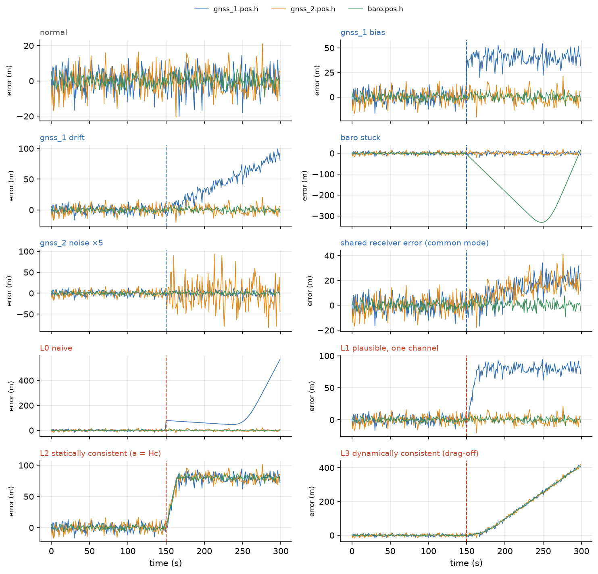
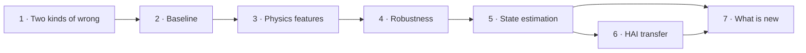

# Telling a broken sensor from a lying one: the course

Seven lessons on detecting false data injection in a cyber-physical system and telling it apart
from genuine sensor faults. They build a navigation chain's telemetry with both kinds of wrong,
show why a standard anomaly detector cannot say which is which, read the physics of an anomaly
to attribute it, attack that classifier on purpose, use state estimation as a lie detector, test
the detection layer on a real industrial testbed, and end with an honest account of what is and
is not new. Each lesson derives the method, walks through the code in this repository, checks it
against closed forms or Monte Carlo, applies it to the same synthetic system, and ends with
exercises (answers included).

## Lessons

| # | Lesson | You will learn | Key result |
|---|---|---|---|
| 1 | [Two kinds of wrong](01-two-kinds-of-wrong.md) | exact zero-order-hold kinematics, sizing noise from a 95 % figure, fault types, FDI levels, why $a = Hc$ leaves WLS residuals unchanged | a 413 m drag-off with a residual change of 5.6e-14 |
| 2 | [The detector that can't say why](02-the-detector-that-cannot-say-why.md) | rate checks and their false-alarm budget, Isolation Forest, detection by family | AUC 0.85, but 0.197 as a test of "attack, not fault" |
| 3 | [Reading physics in an anomaly](03-reading-physics-in-an-anomaly.md) | residuals that are N(0, 1) when healthy, telescoping window variances, gradient boosting, a 1-D CNN | faults 0.99, L0–L2 recognised 0.99–1.0, L3 called normal 0.992 |
| 4 | [When the attacker knows the physics](04-when-the-attacker-knows-the-physics.md) | noncentral chi-square detection, the $(1-s)^2$ law, exact scenario false-alarm rates, the Bayes limit on mimicry | attribution breaks at $s$ = 0.8–0.9; an exact fault mimic is always called a fault |
| 5 | [State estimation as a lie detector](05-state-estimation-as-a-lie-detector.md) | Kalman filter with a bias state, DARE, NIS tests and CUSUM, the dynamic stealth theorem, IEEE 14-bus | receivers-only spoofing missed 3 % instead of 51 %; a protected baro covers only its axis |
| 6 | [Testing on someone else's plant](06-testing-on-someone-elses-plant.md) | HAI, PCA residual and one-step predictor as data-driven consistency checks, per-second vs per-event measures | 5/5 and 15/20 attack events; the longest false alarm is an unseen operating point |
| 7 | [What is (and isn't) new](07-what-is-and-isnt-new.md) | reproduction vs application vs contribution, security indices, the project's limits | the theorems are known; the stealth-dial evaluation and the measured attack-tree probability are the contribution |

Read them in order. Lesson 6 can be skipped by readers without the dataset; its numbers are in
the results file.

## Prerequisites

* Linear algebra: projections, rank, least squares.
* Probability: Gaussian and chi-square distributions, Bayes' rule.
* Some exposure to state estimation or control helps; Lessons 4 and 5 derive what they use.
* Python with NumPy, to follow the code walkthroughs.

## How to use it

* Every lesson links its code, tests and results. The numbers in the lessons come from
  [`validation/results/`](../../validation/results/), regenerated by
  `uv run python validation/run_all.py`.
* Each lesson has an executed [notebook](../../notebooks/) with a small, fast version of its main
  computation.
* The [report](../report.md) is the short version for readers who want the findings, not the
  derivations. The [theory notes](../) summarise each module.
* Scope: synthetic data and public methodology only; attacks are modelled as values on the bus,
  never as ways to get them there ([`scope.md`](../scope.md)).

## Reference texts

* Y. Bar-Shalom, X. R. Li and T. Kirubarajan, *Estimation with Applications to Tracking and
  Navigation*, Wiley, 2001: Lessons 1, 3, 5.
* A. Monticelli, *State Estimation in Electric Power Systems*, Kluwer, 1999: Lessons 4, 5.
* P. D. Groves, *Principles of GNSS, Inertial, and Multisensor Integrated Navigation Systems*,
  2nd ed., Artech House, 2013: Lessons 1, 5.
* Y. Liu, P. Ning and M. K. Reiter, ACM CCS 2009, and the papers in
  [`related-work.md`](../related-work.md): Lessons 4, 5, 7.
